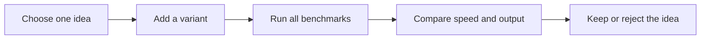

# colibri-poc

A long-running lab with one goal: run **GLM-5.x (744B MoE) on a 32 GB Apple M6 at
5 tokens per second or more**, with usable answers.

- **Read first:** [the lab guide](docs/00-lab-guide.md): mission, bottleneck model,
  how to try ideas, how to follow research.
- **Current scoreboard and every experiment:** [experiment log](docs/12-experiment-log.md).
- **Results website:** https://kakkoidev.github.io/colibri-poc/
- **Research reviewed so far:** [research/watchlist.md](research/watchlist.md).

The GLM work started from a user-reported 0.1 token/s. The lab's earlier rounds used
a small stand-in model, **OLMoE-1B-7B-0125-Instruct, MLX 4-bit (~3.89 GB)**, to learn
expert streaming safely; those results do not transfer directly to GLM.

## All docs

0. [Lab guide: mission, method and how to continue](docs/00-lab-guide.md)
1. [How the pieces fit](docs/01-how-it-works.md)
2. [Can I convert a model to Metal?](docs/02-conversion.md)
3. [How we measure a win](docs/03-benchmarks.md)
4. [Research and PoC ideas](docs/04-research-and-pocs.md)
5. [Can more RAM make GLM faster?](docs/05-more-memory.md)
6. [First measured results](docs/06-first-results.md)
7. [Kernel and KV experiments](docs/07-experiment-round-two.md)
8. [Expert streaming and cache experiments](docs/08-expert-streaming.md)
9. [Resident versus streaming experiments](docs/09-two-track-experiments.md)
10. [Candidate next experiments](docs/10-next-experiments.md)
11. [GLM-5.3 on this Mac: what limits it](docs/11-glm-on-this-mac.md)
    Results page: `site/index.html` (GitHub Pages via `.github/workflows/pages.yml`; preview with `python3 -m http.server --directory site`).
12. [GLM experiment log](docs/12-experiment-log.md) (add one: `.venv/bin/python glm_lab.py try ID "Title" --env KEY=VALUE`)
13. [AI takeover instructions and live state](EXPERIMENT_HANDOFF.md)



## Run

The initial environment and download are prepared locally. To recreate them:

```sh
make setup
make download
make test
make smoke
make bench
```

`make bench` discovers every JSON file in `variants/`, runs them **one at a time**,
and repeats in alternating order. Results appear under `results/<timestamp>/`:

- `summary.md`: readable comparison;
- `summary.json`: machine-readable comparison;
- `campaign.json`: model revision, package versions, configurations, raw rows and failures;
- per-run JSON and logs: generated text, token IDs and timing.

A quick comparison:

```sh
.venv/bin/python bench.py run --rounds 2 --tokens 64
```

To automatically rerun after edits to variants, PoCs, prompts or the runner:

```sh
.venv/bin/python watch.py --rounds 2 --tokens 128
```

It runs once immediately, then watches for edits. Stop with Ctrl+C. It never
starts parallel campaigns; an existing campaign holds an exclusive lock.

No server or existing Ollama settings are changed. Avoid other inference during
measurement. A warmup request runs before each measured workload. The runner
requires Metal and explicitly selects the GPU; it refuses a CPU fallback.

## Add an experiment

Copy `variants/baseline.json`, give it a unique name and change one setting.
Configuration variants currently support prefill chunk size and KV quantization.
For code experiments, add `"plugin": "pocs/my_experiment.py"`; its
`install(variant)` hook executes before loading the model. See `pocs/example.py`.

The three initial variants test prefill chunks of 256, 512 and 1024 tokens.
They are plumbing checks, not expected breakthrough optimizations.

This first runner is an **MLX adapter**, not a modified Colibri engine. A pinned
Colibri source checkout is kept under `engines/colibri` for later engine work.
OLMoE's Colibri engine has no native Metal path at the inspected commit; its MLX
implementation does. Colibri's merged-int8 weights and these MLX 4-bit weights
are different quantizations, so their speed comparison alone is not a kernel A/B.

Model files and raw local benchmark results are ignored by Git. Reviewed public
archives live in `published-results/`; local home paths are replaced with `~`.
Export a completed run with `python publish_results.py <campaign-folder-name>`. See `docs/03-benchmarks.md` before drawing conclusions.

## Published measurements

- [Three-round prefill campaign](published-results/20261017T163907.740295Z/by-prompt.md)
- [Three-round KV-cache campaign](published-results/20261017T164710.744425Z/by-prompt.md)

- [Follow-up experiments and tradeoffs](docs/07-experiment-round-two.md)

The experiment set now includes KV-cache quantization, expert grouping, and
fused gate/up projections. These are candidates, not recommended defaults.
Rejected numerical variants live under `variants/rejected/` and are not discovered
by the default runner. Run optional real-Metal numerical checks with
`COLIBRI_GPU_TESTS=1 make test`.

- [Compact fusion: small candidate gain, matching outputs](published-results/20261017T165212.334140Z/by-prompt.md)
