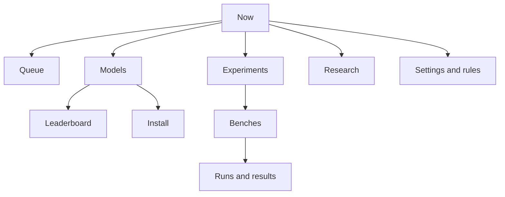

# Brief: GLM lab control app (local web app)

For a Designer AI. Design a lightweight web app the owner uses on their Mac to run and
follow the GLM speed lab: what is running, which models exist, how fast and how good each
one is, what to install next, which experiments to run, and the benches every model gets.

Read first for context: [docs/00-lab-guide.md](../../docs/00-lab-guide.md) (mission and
method). The public results page ([glm-performance-page.md](glm-performance-page.md),
https://kakkoidev.github.io/colibri-poc/) stays separate: it is read-only and public. This
app is **private, local, and can start and stop work**.

## Goal and users

- **Mission it serves:** GLM-5.x on a 32 GB Apple M6 at **5 tok/s or more** with usable
  answers. Today: ~0.44 tok/s exact, ~1.9 tok/s usable lossy.
- **Primary user:** the owner, checking in a few times a day, sometimes from a phone on the
  same network, sometimes leaving long jobs overnight.
- **Secondary user:** AI agents (Claude sessions, the monthly research scan) that add
  experiments and results through the same files. The app must show their work too.
- **The one question every screen answers:** "What is the Mac doing, what did we learn, and
  what should run next?"

## Hard rules the design must make visible

These come from how the lab works. Each needs a visible UI behaviour, not just a rule.

| Rule | UI behaviour |
|---|---|
| One GPU job at a time (`.bench.lock`) | A single "Now running" slot. Starting anything while it is busy adds it to the queue instead. Never two "Run" buttons that both start at once. |
| Stop processes by PID only | "Stop" shows the exact process (PID, command, how long it ran) and asks to confirm. Never "stop all". |
| Downloads need explicit consent | Before any download: source repo, file names, download size, size kept, free disk after, and the experiments it unlocks. Confirm button states the size ("Download 282 GB"). |
| Never change the owner's engine or model folder | No button edits `~/Code/colibri` or `~/colibri-models/glm-5.3`. New engines and models appear as separate entries. |
| Lossy results are labelled | Every result that changes the model's computation carries a "changes output" tag, everywhere (lists, charts, leaderboards). |
| "Usable" lossy needs the owner | Only the owner can mark a lossy setting usable, and only after its quality bench exists. Agents' results show "awaiting your review". |
| Busy machine skews timings | Show free RAM and other heavy apps next to "Now running". Results record whether the run was quiet (via `glm_quiet.py`) or busy. |
| Resumable jobs | A paused bench shows "Paused at 42/144 · Resume". Resuming never loses finished work. |

## Information architecture

Navigation: Now · Models · Leaderboard · Experiments · Benches · Install · Runs · Research ·
Settings. On a phone, Now and Queue come first.

## Screens

### 1. Now (home)

Purpose: what the Mac is doing this second, and what happens next.

- **Now running card:** job type (experiment, quality bench, quiet run, download, prep),
  name, model, engine, progress (e.g. "Bench v1: 42/144 · logic-sisters · d050"), elapsed time,
  ETA from past durations, current tok/s if available, PID with a **Stop** action.
- **Machine health strip:** free RAM, swap used, free disk, largest other apps by memory,
  SSD activity (busy/idle), and whether conditions count as "quiet" (≥ 20 GB free).
- **Queue preview:** next 3 jobs with ETAs; link to Queue.
- **Scoreboard:** best exact and best usable lossy tok/s vs target 5, as a progress bar
  ("38% of target"), with the experiment that set each.
- **Recent results:** last 5 finished runs/experiments with verdict chips
  (improves / no clear change / worse / failed).
- **Needs you:** items waiting on the owner. Examples: downloads to approve, lossy results to
  review, research "options that need your OK", failed runs.

States: idle (nothing running, queue empty, offer the next planned experiment), running,
paused, blocked (lock held by something the app did not start), failed (last job failed:
show the log tail and "Retry").

### 2. Queue

Ordered list of jobs to run one after another. Reorder by drag and by keyboard (move
up/down buttons). Each item: type, name, model, estimated duration, prerequisites (e.g.
"needs 3-bit GGUF installed", "needs a quiet machine"), and status (waiting, blocked on
prerequisite, running, done, failed). Options per item: run only when quiet (≥ 20 GB free),
run overnight only. A paused job keeps its place.

### 3. Models

Every model the lab can run, installed or not.

Per model card: name, family (GLM-5.3, GLM-5.3-Flash, …), parameters (total / active),
format and bits (Colibri int4, GGUF IQ3_XXS, …), size on disk, location, engine needed
(installed engine, dev clone `engines/colibri-<sha>`, `glm53`), extras (MTP head yes/no),
status (installed, downloading %, preparing, not installed, failed), and quick facts: best
exact tok/s, best usable lossy tok/s, quality score (if benched), bench coverage (e.g. "3 of 5
standard benches").

Filters: installed / not installed, family, format. Detail page: all runs on this model,
its bench coverage matrix row, its prep command, disk usage, and "Uninstall" (owner-only,
never for `glm-5.3`, with size freed shown).

### 4. Leaderboard ("strongest" and "fastest")

Two rankings side by side, with the trade-off visible:

- **Strongest:** quality bench accuracy (graded prompts: facts, maths, logic, code with
  tests), per config (exact, skip 0.3, skip 0.5) and prompt style (normal, terse). Optional
  external scores (e.g. vendor or Artificial Analysis) shown as "reported, not measured here".
- **Fastest:** generation tok/s, prompt reading time and mean answer time with the standard
  settings, exact and lossy separately.
- **Speed vs quality chart:** one point per model × config (x = mean answer time or tok/s,
  y = % correct). Exact solid, lossy hatched or outlined. Target line at 5 tok/s.
- **All model speeds table:** model, config, threads, tok/s, prompt reading s, answer s, %
  correct, quiet or busy, date, run link. Sortable.

Rules: never rank a lossy config above an exact one without its tag; show "not benched"
instead of blanks; show run count (single runs vary ~10%).

### 5. Experiments

The experiment registry (`experiments/glm-experiments.json`) as a working list.

- **Tabs:** Planned (ready / blocked) · Running · Done · Ideas not run.
- **Experiment row:** title, category, change (env/flags), model, engine, hypothesis,
  reference run, verdict chip, effect ("generation +19%", "output changed"), tags (lossy,
  usable, awaiting review).
- **Planned item:** shows its readiness. Ready means its model, engine and machine
  conditions are met; otherwise "blocked: needs 3-bit GGUF (282 GB) · Install". Actions:
  Run now (if the GPU is free), Add to queue.
- **New experiment form:** title, category, hypothesis, model, engine, env settings
  (key/value rows with known Colibri settings suggested), prompt (sky / code / custom), tokens,
  reference run (suggested automatically), lossy toggle, repeats. "Stack" option: combine
  existing winners into one experiment.
- **Done item detail:** before → after numbers, output identical or changed (with a text
  diff of the answers), conclusion and tradeoffs (editable), sources, run logs.

### 6. Benches (the standard suite every model gets)

Defines and tracks the benches that run on every model, so models are comparable.

Standard suite (v1, from the lab today):

| Bench | What it measures | Duration (int4, busy Mac) |
|---|---|---|
| Speed reference | sky + code prompts, exact and skip 0.5, 12 threads | ~10 min |
| Quality bench | 24 graded prompts × configs × normal/terse styles | hours (~2-6 h) |
| Quiet comparison | key speed cases repeated on a quiet machine | ~45 min |
| RAM sweep | exact runs at larger RAM budgets | ~10 min |
| Thread sweep | 2 / 6 / 12 threads | ~15 min |

- **Coverage matrix:** models (rows) × benches (columns). Each cell: done (with date and
  headline number), running, queued, missing, or failed. "Run missing benches for this model"
  adds them to the queue.
- **Edit suite:** add or retire a bench (owner-only), with a note that changes apply to future
  runs only.

### 7. Install (models and engines to install)

A catalog of things we could install, from the research scan and runbooks. Each entry: name,
what it unlocks (experiments by name), source (Hugging Face repo, Colibri commit), download
size, size kept, free disk after, estimated time, prep command (shown for transparency),
status (not started, downloading %, preparing, ready, failed with log), resumable yes/no.

Today's catalog: int8 MTP head (~16 GB down, ~10 GB kept), GLM-5.3 3-bit GGUF (~282 GB),
GLM-5.3 2-bit GGUF (~239 GB), GLM-5.3-Flash 3-bit GGUF (~120 GB), Colibri dev engine clone.

Disk gauge across the top: used, free, and "after selected downloads". Warn if a download
would leave less than ~30 GB free. Downloads can run alongside a bench only if the owner
chooses that: show "will skew the running bench's timings".

### 8. Runs and results

Every engine run: run ID, date, model, engine, settings, prompt, tokens, tok/s, prompt
reading, hit rate, time shares (SSD / math / attention / other), status, quiet or busy.
Filters by model, experiment, date, status. **Downloads:** raw log, generated answer text,
`runs.csv`, a whole experiment or bench as a zip. Raw logs are local only. Published copies
must never contain home paths; offer "Publish" as an explicit owner action that runs
`publish_glm_runs.py` and shows what will be pushed.

### 9. Research

The research watch list (`research/watchlist.md`) and the monthly scan's reports: items with
decision chips (tested / candidate / watch / rejected), date, link, and "Create experiment"
for candidates. "Options that need your OK" from the latest scan appear here and on Now.
Show the next scheduled scan date.

### 10. Settings and rules

Paths (repo, installed engine, models folder), default settings for runs (the best exact
set), quiet threshold (20 GB), max scheduled runtime, notification preferences, and a read-only
list of the hard rules above.

## Data the app reads (real sources today)

| Data | Source today | Notes for the design |
|---|---|---|
| Experiments, verdicts, scoreboard | `experiments/glm-experiments.json`, `site/data/experiments.json` (`glm_lab.py log`) | Fields: id, title, category, change, hypothesis, ref, runs, lossy, usable, verdict, conclusion, tradeoffs, sources, plan |
| Planned experiments and readiness | `glm_lab.py planned` / `run-planned` | Readiness depends on model, engine and machine |
| Engine runs | `published-results/glm-20261018/runs.csv` + `<run>.output.txt`; raw logs in `results/glm-raw-20261018/logs/` | Columns include tok_s, prefill_s, hit_pct, time shares, omp_threads, rss_gb, status |
| Quality bench | `results/glm-bench-<name>/*.json`, `summary.json` (`glm_bench.py`) | Progress "N/144" from the runner's output |
| Quiet runs | `results/glm-quiet-<stamp>/comparison.json` (`glm_quiet.py`) | Includes machine conditions before/after |
| What is running | `.bench.lock` holder (`lsof`), engine processes, job PIDs | The app must show jobs it did not start too |
| Machine state | `vm_stat`, `sysctl vm.swapusage`, `df`, process list | As in `glm_quiet.py check` |
| Research | `research/watchlist.md`, scan reports in `research/` | Table rows with decision and date |
| Install catalog | `Makefile` `glm-prep-*` targets, `scripts/prep_*.sh`, runbook | **Gap:** needs a `models/catalog.json` (name, source, sizes, unlocks, prep command) |
| Models installed | folders in `~/colibri-models/` | **Gap:** needs model metadata (family, bits, engine, quality) in the same catalog |
| Bench suite and coverage | implicit today | **Gap:** needs a `benches/suite.json` and per-model coverage |

Design for these shapes; the gaps will be filled when the app is built.

## Visual direction

- Match the public page's neutral look: system fonts, greys, **blue = exact**, **orange with
  hatching = lossy ("changes output")**. Not the MeetsMore design system.
- Dense but calm: a working tool checked several times a day, not a marketing page.
- Status colours must differ in lightness too, not hue alone; every status also has a word
  (running, paused, blocked, failed, done).
- Light and dark mode. Desktop first, but Now, Queue and Stop must work well at 375 px.
- Numbers use tabular figures; every number shows its unit (tok/s, s, GB) and, where single
  runs, a "single run" hint.

## Interaction details

- Long jobs show live progress (updates every few seconds) without a full page reload.
- Every destructive or expensive action (stop, uninstall, download, publish) has a
  confirmation that names exactly what will happen, with sizes and PIDs.
- Empty states teach: e.g. Benches with no coverage say which command or button fills them.
- Errors show the last ~20 lines of the job's log and a link to the full log.
- Notifications (optional): job finished, job failed, download done, scan found something
  worth testing.

## Out of scope for v1

- Remote access from outside the home network (local only: `127.0.0.1` or LAN by choice).
- Running more than one GPU job at once.
- Editing Colibri source or building the owner's engine.
- Multi-user accounts.

## Deliverables

1. Screens for: Now (idle, running, blocked, failed), Queue, Models (list + detail),
   Leaderboard, Experiments (list, new-experiment form, done detail with answer diff), Benches
   (coverage matrix), Install (catalog + download confirmation), Runs (list + download),
   Research, Settings.
2. Phone layouts for Now and Queue.
3. Component set: job card, status chip, verdict chip, lossy tag, model card, coverage cell,
   disk gauge, confirmation dialog.
4. A short note on any data the screens need that the table above does not provide.

## Acceptance checklist

- [ ] At a glance on Now: what is running (with PID and progress), what is next, machine
      health, scoreboard vs 5 tok/s, and what needs the owner.
- [ ] Every model's speeds (exact and lossy) and strength (quality bench) are visible and
      comparable, with "not benched" shown explicitly.
- [ ] Planned experiments show whether they are ready and, if not, exactly what blocks them.
- [ ] The standard bench suite and its per-model coverage are visible in one matrix.
- [ ] Downloads cannot start without a confirmation that shows source, size and disk after.
- [ ] Stop always names the PID; there is no "stop all".
- [ ] Lossy results carry "changes output" everywhere; "usable" is owner-only.
- [ ] Works at 375 px for Now/Queue; light and dark; status not by colour alone.
