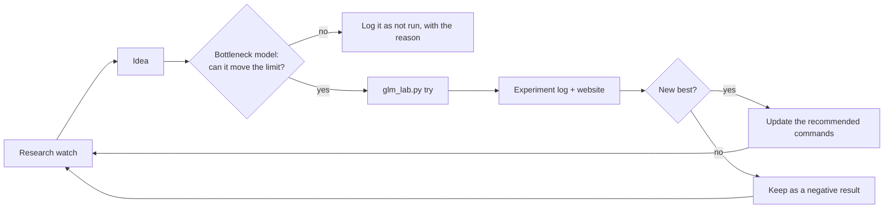
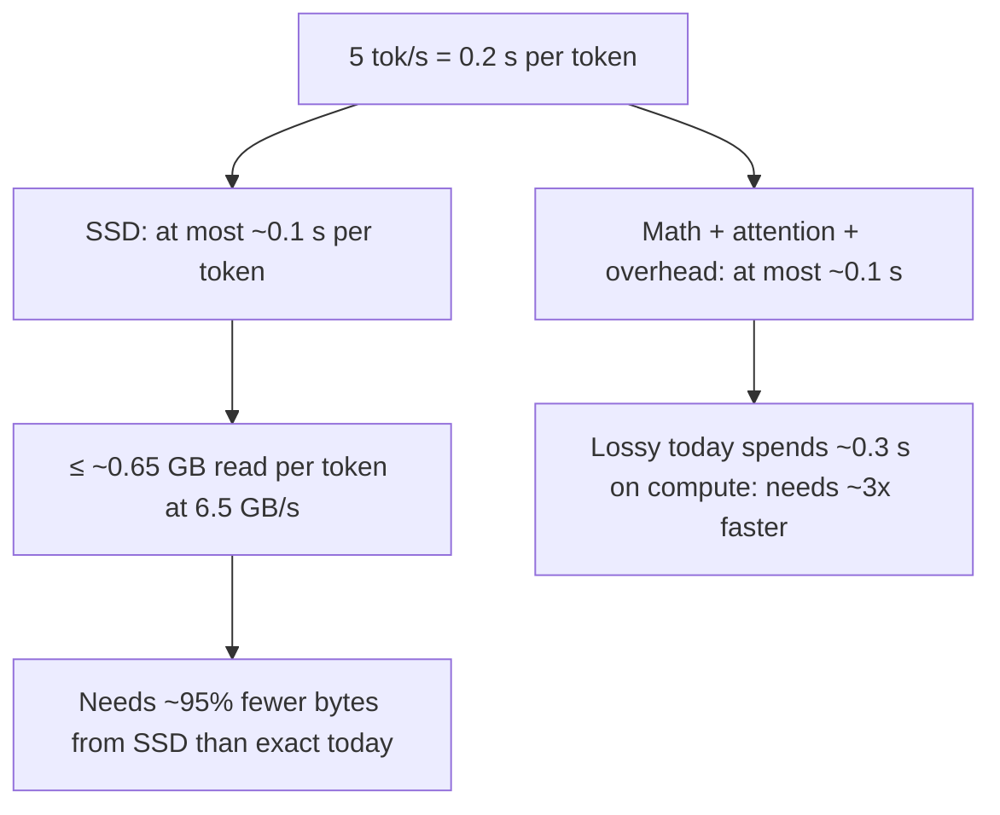
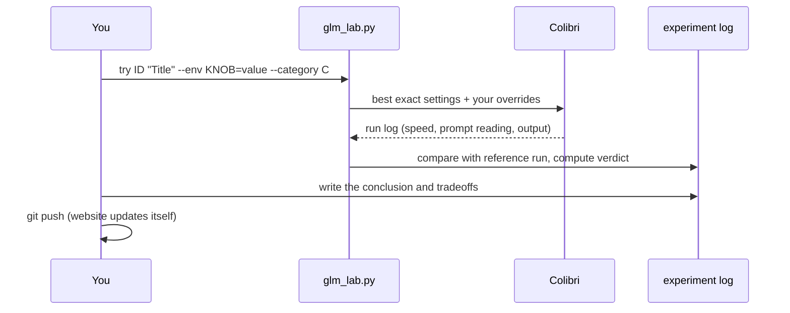
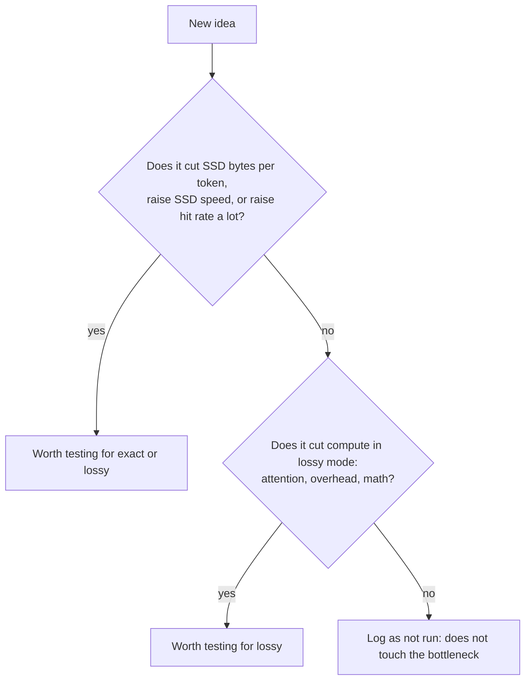

# GLM speed lab: the long-term guide

**Mission:** run GLM-5.x (744B mixture-of-experts) on the owner's 32 GB Apple M6 at
**5 tokens per second or more**, with answers good enough to use.

This is a multi-year project. Hardware, Colibri, the models and the research will all
change. This guide explains how to keep trying ideas, measure them the same way every
time, and keep up with new research, so any person or AI agent can pick it up cold.

Start here, then read [the experiment log](12-experiment-log.md) for the current
scoreboard and [GLM on this Mac](11-glm-on-this-mac.md) for the detailed findings.



## 1. Where things stand

The numbers live in generated files, so they never go stale in prose:

- **Scoreboard** (best exact, best usable lossy, gap to 5 tok/s): top of
  [docs/12-experiment-log.md](12-experiment-log.md) and
  `site/data/experiments.json` → `scoreboard`.
- **Website:** https://kakkoidev.github.io/colibri-poc/ (redeploys on every push that
  touches `site/`).

As of 2026-10-18: exact ~0.44 tok/s (about 4× the start), usable lossy ~1.9 tok/s
(skip < 0.5, 12 threads), target 5 tok/s.

## 2. Why it is slow: the bottleneck model

Use this model to decide whether an idea can matter *before* spending time on it.

Per generated token, GLM picks 8 of 256 experts in each of 75 MoE layers. With the
int4 model that is **~12.7 GB of expert weights per token**. Time per token is roughly:

```
time per token ≈ SSD time + GPU/CPU math + attention + overhead
SSD time       ≈ 12.7 GB × (1 − cache hit rate) × (share not skipped) / SSD speed
```

| Quantity | Today on this Mac | Where measured |
|---|---|---|
| Expert bytes per token | ~12.7 GB | Colibri `[PROF] expert I/O` |
| Cache hit rate | ~2% (RAM leaves ~1.6 GB for experts) | `expert hit rate` |
| SSD speed (random 21 MB reads) | ~6.5 GB/s max, flat beyond 2 readers | `iobench` |
| Exact time split | ~76% SSD, rest math and attention | `[PROF] time shares` |
| Lossy (skip 0.5) split | ~45% SSD, ~35% attention, ~10% other | `[PROF] time shares` |



**What 5 tok/s requires** (combinations, not single fixes):

| Lever | What changes bytes or time | Rough size of the effect |
|---|---|---|
| Bigger cache (more RAM) | hit rate | ~100 GB of cache ≈ 82% hits (from usage history) |
| Faster or more storage | SSD speed | second NVMe via `COLI_MODEL_MIRROR`: up to ~2× |
| Fewer bytes per expert | expert size | int3 ~−25%, int2 ~−50% (lossy); lossless rANS ~−24% (no loader yet) |
| Fewer experts read | skipped share | skip < 0.5 skips ~84% of misses (lossy, quality cost) |
| Faster compute | math, attention, overhead | threads (+19% lossy), Metal kernel work, a faster chip |
| Fewer forward passes | tokens per pass | speculative decoding (MTP head or drafts), if accepted drafts outweigh extra expert reads |

Exact output on this exact Mac cannot reach 5 tok/s through settings alone: the SSD
ceiling is ~0.5–0.65 tok/s. Reaching the goal needs at least one of: much more RAM,
much faster storage, smaller experts, or accepting a quality trade, plus faster compute.

## 3. Set up from scratch

```sh
brew install libomp                        # without it Colibri silently builds single-threaded
make -C ~/Code/colibri/c clean glm METAL=1  # Metal GPU backend
otool -L ~/Code/colibri/c/colibri | grep -E 'libomp|Metal'   # both must appear
```

Recommended exact run (identical output, fastest known):

```sh
COLI_METAL=1 PIPE=1 DIRECT=1 COLI_METAL_RESSET=1 COLI_METAL_SPIN=1 OMP_NUM_THREADS=12 \
  ~/Code/colibri/c/coli chat --model ~/colibri-models/glm-5.3 --ram 18 --ctx 1024
```

**Prompt style: terse (owner decision, 2026-10-18).** End every prompt with " Answer as
briefly as possible. For code, reply with only the code." Quality bench v1: exact answers in
~64 s instead of ~281 s, 24/24 correct in every config. Generation speed is unchanged; the
answers are just much shorter. Colibri's `chat` has no system-prompt option, so add the
sentence to the prompt itself. Future quality benches should always include the terse style.

Fastest usable lossy run: add `DEGRADE_ZERO=1 DEGRADE_TAU=0.5`. It changes output; at
0.7 grammar breaks, at 1.0 it loops. `OMP_NUM_THREADS=12` works around Colibri using
only the M6's 2 "Super" cores ([colibri#2194](https://github.com/JustVugg/colibri/issues/2194));
drop it once that issue is fixed upstream.

Lab Python: `uv venv --python 3.12 && uv pip sync requirements.lock` (see `make setup`).

## 4. Try an idea: the experiment workflow



1. **Check the machine is free.** One GPU job at a time. If the quality bench is
   running, stop it by PID (`ps aux | grep glm_bench`); `make glm-bench` resumes it.
2. **Run it:**
   ```sh
   .venv/bin/python glm_lab.py try my-idea "What I'm trying" --env KNOB=1 --category io \
     --hypothesis "Why it should help"
   ```
   Options: `--prompt sky|code|"any text"`, `--ngen` (match the reference run's
   length, 24 for `sky`/`code`), `--ref RUN` (defaults to the 12-thread exact run for
   that prompt), `--lossy` if it changes the model's computation, `--no-base` to skip
   the best settings (e.g. testing an old engine).
3. **Repeat anything that looks like a win.** Single runs vary ~10%. Run the same
   change again under another ID, or use `glm_quiet.py` for repeats.
4. **Write the conclusion.** Edit the entry in `experiments/glm-experiments.json`
   (`conclusion`, `tradeoffs`, `sources`, and `usable: true` for an acceptable lossy
   setting), then `.venv/bin/python glm_lab.py log`.
5. **Ideas you decide not to run** still get an entry with `"verdict": "not run"` and
   the reason, so nobody re-investigates them blindly.
6. **Commit and push.** The website and scoreboard update by themselves.

Verdict rules: generation +10% or better → improves; −10% or worse → worse; prompt
reading 20% faster → improves; any failed run → failed. Peak memory (RSS) is recorded
but not judged: identical runs varied 6–9 GB.

### Planned experiments and the quiet run

An idea that should run later (machine busy, needs a download, needs a quiet Mac) gets a
registry entry with `"verdict": "not run"` and a `plan` (prompt, length, env, reference,
engine clone with `build`, model, `needs` paths and the `prep` command). Then:

- `make glm-planned` lists them and says which are ready.
- `make glm-quiet` (`glm_quiet.py run`) runs every ready one after its comparison set;
  `glm_quiet.py run --experiments-only` runs just those. Wins (>= +10%) are repeated once
  automatically.
- Entries that need a download wait for `make glm-prep-mtp` (int8 MTP head) or
  `make glm-prep-iq2m` (2-bit GGUF); nothing downloads without the owner running these.

### Stack techniques, then carry the stack to new models

Small gains compound. Every single-technique result is also tried **on top of the
current best stack** (best exact settings + 12 threads, then + skip < 0.5 for lossy),
as `stack-*` entries, because a change can matter more once other bottlenecks are gone:
drafts off barely matters when SSD-bound but may matter when attention-bound. When a new
model or format arrives (2-bit GGUF, GLM-5.3-Flash), run its reference first, then the
whole winning stack, not one lever at a time.

### Quality checks for lossy ideas

A speed win that changes output is not a win until quality is checked:

- Quick: compare the output text in `published-results/glm-20261018/<run>.output.txt`.
- Better: `glm_bench.py run --name NAME --configs exact,<new>`. It runs 24 graded
  prompts (facts, maths, logic, code with tests, explanations) and reports accuracy and
  total answer time. Add the config to `CONFIGS` in `glm_bench.py` first.
- Mark `usable: true` only when accuracy holds and answers stay coherent.

## 5. Measurement rules

- **Same workload every time.** `sky` and `code` prompts, greedy decoding, `--ram 18
  --ctx 1024`, unless the experiment is about those settings.
- **Compare against a reference run made on the same day and engine build** when
  possible. After any Colibri update, re-run the reference first (section 7).
- **Busy machine.** Results so far come from an everyday Mac with many apps open.
  Say so in every report. `make glm-quiet-check` then `make glm-quiet` (~45 min)
  repeats key runs with apps closed, including the original engine.
- **Never retype numbers.** Raw logs go to `results/` (local, ignored);
  `publish_glm_runs.py` writes path-free copies to `published-results/`; the log and
  the website read only those.
- **Label lossy results everywhere** ("changes output").
- **Keep negative results.** They are as valuable as wins.
- **Do not change the owner's Colibri state.** Test runs use `USAGE_SAVE=0 KVSAVE=0
  --no-tune-profile`.

## 6. Follow the research

Cadence: a scheduled task (`glm-research-scan`, Claude desktop app, 1st of each month
at 10:00) does the monthly scan, updates the watch list, plans experiments for new
possibilities and runs the quick safe ones itself (settings on the installed engine, or a
new Colibri version built in a separate clone under `engines/`, only when the machine is
free, at most ~8 runs). Anything needing a download, install, hardware or a lossy quality
judgement is reported as an option for the owner. Do a deeper scan each quarter or when a new Colibri release, GLM release or
Apple chip lands. Record every item reviewed in
[research/watchlist.md](../research/watchlist.md), including the ones rejected.

Where to look:

| Source | What to watch for |
|---|---|
| [Colibri releases and issues](https://github.com/JustVugg/colibri) | new formats (rANS loader), Metal kernels, MTP for GLM-5.x, fixes to colibri#2194 |
| arXiv (cs.LG, cs.DC, cs.AR) | MoE offloading, expert caching and prefetch, expert quantization, speculative decoding with MoE |
| Hugging Face (zai-org, JustVugg, community) | new GLM releases, smaller/pruned/distilled variants, lower-bit Colibri conversions |
| llama.cpp, MLX, KTransformers, vLLM | techniques that may port to Colibri or replace it |
| Apple hardware | RAM sizes, SSD speeds, GPU memory bandwidth of new Macs |

Search queries that worked: "MoE offloading SSD expert prefetch", "expert caching
Apple Silicon unified memory", "mixed-precision expert quantization 2-bit 3-bit",
"speculative decoding mixture of experts offloading", "GLM-5 REAP pruning".

**Triage every idea with the bottleneck model** (section 2):



Examples already triaged: REAP pruning keeps 8 experts per token, so bytes per token
do not change (not run); prefetching did not help on unified memory (tested, no
change); GPU prompt attention did not help because prompt reading is also SSD-bound.

## 7. When something upstream changes

| Change | What to do |
|---|---|
| New Colibri version | `git pull`, rebuild with `METAL=1` (check libomp linked), re-run the reference runs with `glm_lab.py try` (`baseline-<version>`), compare with the previous baseline before anything else |
| colibri#2194 fixed | try without `OMP_NUM_THREADS` and log it |
| New GLM model or conversion | new reference runs; the old ones only compare within one model |
| New Mac or more RAM | redo `iobench`, `coli doctor`, RAM budgets (`glm_quiet.py run --ram-sweep`), then the reference runs |
| New macOS | check `coli doctor` and re-run the reference runs |

## 8. Files and tools

| What | Where |
|---|---|
| Experiment registry (source of truth) | `experiments/glm-experiments.json` |
| Experiment log (generated) | `docs/12-experiment-log.md`, `site/data/experiments.json` |
| Try an idea | `glm_lab.py try` / `glm_lab.py log` |
| Quality and answer-time bench | `glm_bench.py` (`make glm-bench`), prompts in `glm-prompts.json` |
| Quiet-machine rerun | `glm_quiet.py` (`make glm-quiet-check`, `make glm-quiet`) |
| Publish runs without local paths | `publish_glm_runs.py` |
| Raw logs (local only) | `results/glm-raw-20261018/logs/` |
| Published runs and answers | `published-results/glm-20261018/` |
| Website | `site/index.html`, `site/data/*.json`, `.github/workflows/pages.yml` |
| Detailed GLM findings | `docs/11-glm-on-this-mac.md` |
| Research watch | `research/watchlist.md` |
| Patches to Colibri (test clones only) | `patches/` |
| Original engine backup | `~/Code/colibri-engine-backup-20261018/` |
| AI takeover notes | `EXPERIMENT_HANDOFF.md` |

## 9. Ideas backlog

Kept in the experiment log as `not run` / `in progress` entries so they stay next to
the results. Current candidates, roughly by expected value toward 5 tok/s:

1. **Second fast SSD** (`COLI_MODEL_MIRROR`): biggest exact-mode lever available without
   changing the model. Needs an external NVMe (Thunderbolt 5).
2. **More RAM** (next Mac): the cache curve says ~100 GB of cache reaches ~82% hits.
3. **Lower-bit experts** (int3, mixed precision): cuts bytes per token; lossy and needs
   a Colibri conversion. Watch Colibri and Hugging Face for ready-made conversions.
4. **Lossless rANS experts**: watch for Colibri's loader (PR 2 of the rANS ladder); a
   Metal decode path would make it worth testing.
5. **Metal attention and overhead work**: lossy mode is compute-bound; upstream Metal
   improvements or a contribution would help.
6. **Speculative decoding with an MTP head** for GLM-5.x in Colibri format.
7. **Terse prompting**: fewer generated tokens per answer; measured by the quality
   bench (in progress).
