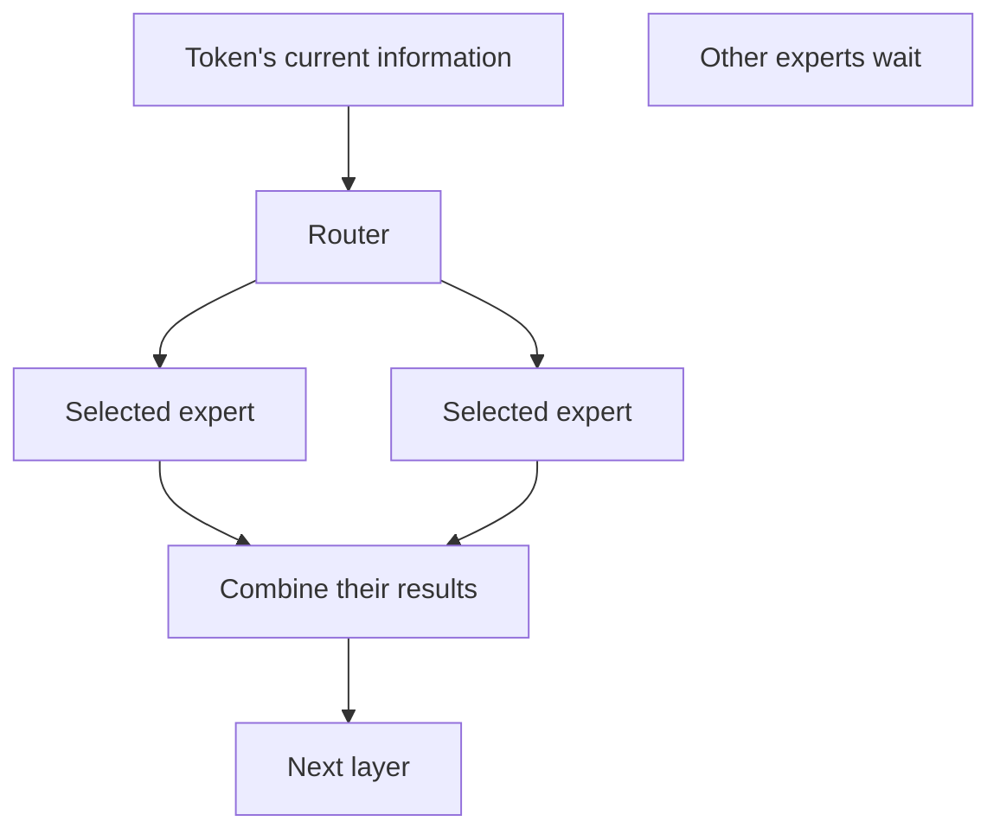
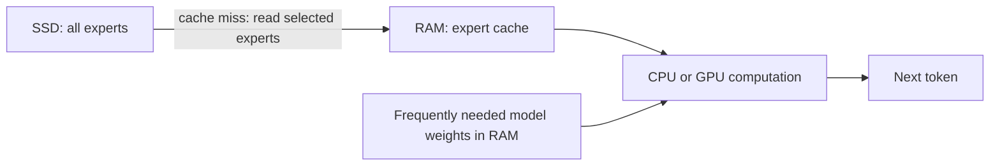

# How it works

A model is a collection of numbers called **weights**, plus a recipe for using
them. A runtime follows that recipe to predict the next token: a word fragment,
punctuation mark, or other text piece.

There are two main phases:

- **Prefill:** read your prompt. Many prompt tokens can be processed together.
- **Decode:** generate the answer. Normally each new token depends on the previous one.

A long prompt can have slow prefill even when answer generation is fast. Measure both.

## What makes MoE different?

MoE means **mixture of experts**. Inside each model layer, a small router chooses
some expert networks. The model does not use every expert for every token.

OLMoE has about 7B parameters stored and about 1B active per token. The total
size decides how much storage/memory we need. The active part helps explain
how much computation each token needs. Neither number alone predicts speed.

## Why Colibri can run huge models

Colibri keeps frequently needed weights in RAM and streams missing experts
from SSD. This saves RAM, but SSD reads can dominate latency.

Apple Silicon has **unified memory**: CPU and GPU share physical memory. A
32 GB Mac does not have 32 GB RAM plus another 32 GB GPU memory.

For our small model, all weights fit. That is great for fast iteration, but a
fully resident result cannot establish a speedup for a huge streamed GLM model.
Later we need an explicitly limited expert cache and honest disk measurements.

Sources: [OLMoE paper](https://arxiv.org/abs/2409.02060),
[Colibri](https://github.com/JustVugg/colibri),
[MLX](https://github.com/ml-explore/mlx).
