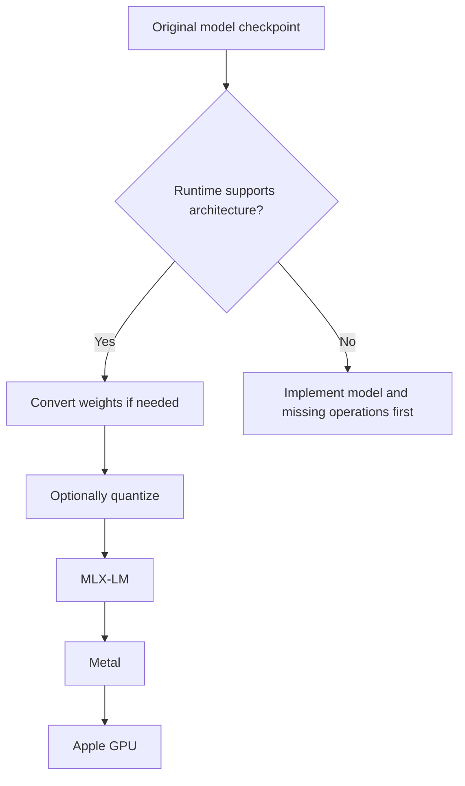
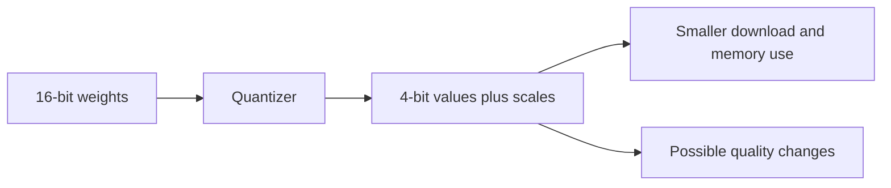

# Can I convert a non-Metal model to Metal?

**Often yes, on this Mac.** More precisely: convert its weights into a format
that a Metal-enabled runtime understands, then run it with that runtime.
Metal itself is Apple's GPU programming API, not a weight-file format.

| Piece | Meaning | Example |
|---|---|---|
| Architecture | The model's recipe | OLMoE |
| Weights | The learned numbers | Safetensors files |
| Quantization | How precisely numbers are stored | 4-bit, 8-bit, BF16 |
| Runtime | Software executing the recipe | MLX-LM, Colibri, llama.cpp |
| GPU backend | How software asks the GPU to work | Metal |



## Example: convert OLMoE locally

This is an optional learning exercise. Our downloaded checkpoint is already
converted; there is no reason to download another copy just to run benchmarks.

```sh
.venv/bin/python -m mlx_lm.convert \
  --hf-path allenai/OLMoE-1B-7B-0125-Instruct \
  --mlx-path models/olmoe-local-conversion \
  -q --q-bits 4 --q-group-size 64
```

The original 7B checkpoint needs roughly 14 GB just for 16-bit weights, plus
working memory. Conversion can use more memory than inference; other running
models reduce available headroom. This command is documented, not yet executed
or measured in this repo. Pin the source revision before comparing conversions.



Conversion rearranges/translates weights. Quantization changes their precision.
They are different operations, even when one command does both.

## What conversion cannot do

- Fit full GLM-5.3 in 32 GB simply by choosing MLX.
- Add missing Metal kernels or architecture support.
- Turn an NVIDIA CUDA-only kernel into an Apple GPU kernel.
- Restore precision lost in an earlier quantization.

A GGUF model can already use Metal through llama.cpp when supported. It does
not need an MLX conversion for that. Renaming GGUF or Colibri files to
`safetensors` is not conversion. Prefer original supported checkpoints or a
trusted existing conversion; specialized quantized formats may need a real
converter and may incur additional rounding loss.

Sources: [MLX-LM conversion instructions](https://github.com/ml-explore/mlx-lm#quantization),
[llama.cpp Metal support](https://github.com/ggml-org/llama.cpp),
[our MLX checkpoint](https://huggingface.co/mlx-community/OLMoE-1B-7B-0125-Instruct-4bit).
