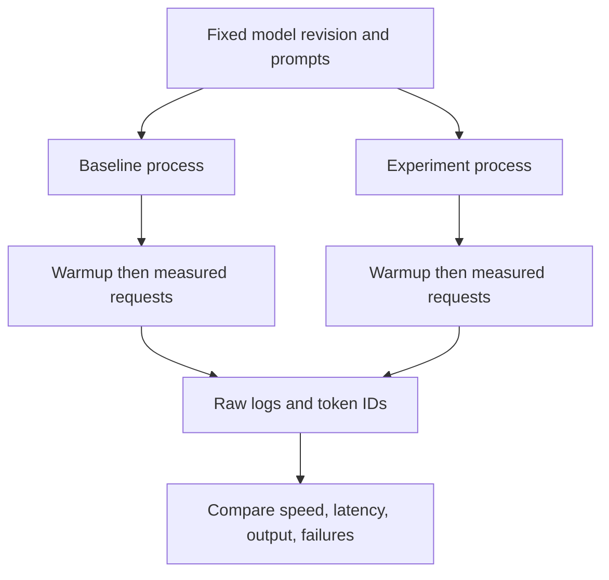

# How we measure a win

Change one thing, run the same work, measure speed, and check that the result is
still acceptable. Keep negative results too.

## What the runner records

| Metric | Meaning |
|---|---|
| Load seconds | Model load and GPU synchronization |
| First token seconds | Time until first generation response |
| First text seconds | Time until first nonempty decoded text |
| Prompt tokens/second | MLX-LM's prefill measurement |
| Decode tokens/second | MLX-LM's generation measurement |
| Request seconds | Whole generation call, including prefill |
| Peak GPU GB | MLX allocation high-water mark, not total system RAM |
| Token IDs and text | Check whether a faster run changed the answer |
| Finish reason and length | Detect early stopping and truncated answers |

Warmup is excluded from headline results. Each variant runs in its own process,
loads the same local weights and creates fresh KV state for each prompt. The
OS file cache is **uncontrolled**. These are resident-model benchmarks, not cold
SSD measurements. Load time must not be labelled cold load time.

The runner executes serially, alternates order between rounds, retains failures,
and calculates per-prompt speed ratios against the baseline in the same round.
It reports the median of these ratios plus output equality flags. It does not
hide an unsuccessful experiment by silently retrying it.

Exact token equality is a useful guard, not a complete quality benchmark.
Different floating-point reduction orders can change a near-tie token. If output
changes, inspect the answer and add held-out perplexity/task evaluation before
claiming a quality-preserving win. Equal answers are not guaranteed to be correct.

## How Colibri measures

Inspected upstream commit: `e0db083cdc9e563e0766cc6fc661ef23c32298e0`.

- `c/tools/datapoint.py` keeps an engine alive for cold, warm-identical and rotating
  requests. It reads counts, decode rate, expert hit rate and RSS from engine frames.
- Rotating prompts are its primary serving result; repeating one prompt can
  exaggerate cache benefits.
- `c/colibri.c` times prefill separately, then divides generated tokens by decode time.
- Its replay mode feeds fixed tokens, so backend differences do not silently change
  which experts the workload requests.
- `c/tools/benchmark_http_serving.py` also measures API requests and queueing.
- Process restart does not clear the OS file cache. On macOS, `F_NOCACHE` does not
  prove old cached pages were evicted.

Our first adapter follows the repeatable-workload principle but uses MLX-LM's
own timing boundaries. Rates from different runtimes are not automatically
identical definitions. Always keep wall time, actual token counts and latency.

## Next instrumentation

For streaming PoCs add bytes read, cache hits, wrong prefetches, disk-wait time,
GPU execution time, compression and swap changes. Do not estimate disk bytes
from cache misses if the actual reads can be counted. A small model can remain
in the OS page cache even with a restricted application cache; label that case.

Sources: [Colibri protocol](https://github.com/JustVugg/colibri/blob/main/docs/benchmarking.md),
[collector](https://github.com/JustVugg/colibri/blob/main/c/tools/datapoint.py),
[MLX-LM generation](https://github.com/ml-explore/mlx-lm/blob/main/mlx_lm/generate.py).
