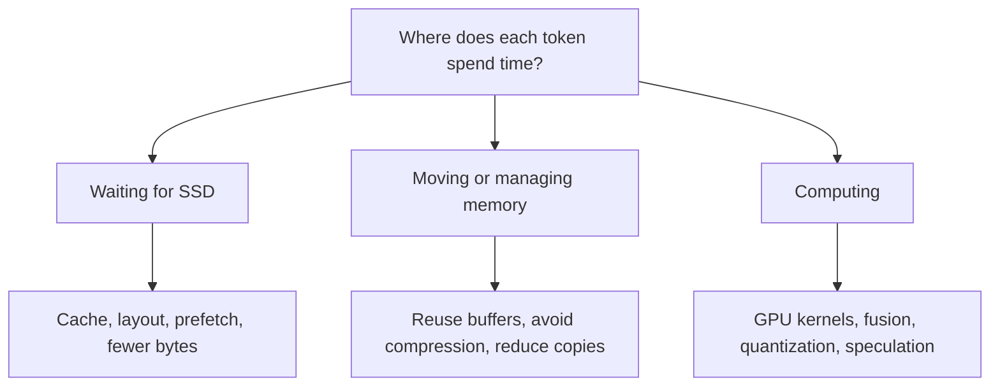
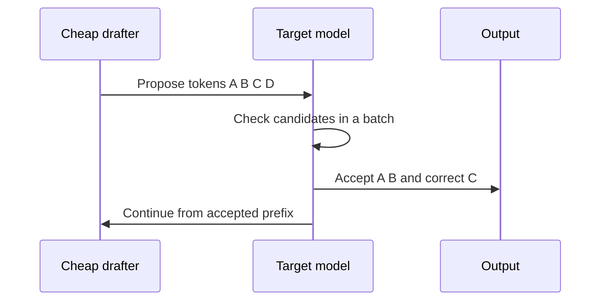

# Research and PoC ideas

Research snapshot: **18 October 2026**. This is a practical survey of relevant
work, not a claim to cover every discussion. Published speedups belong to their
own models, baselines and hardware; they are not predictions for this Mac.

## Start with the bottleneck

If 90% of time is disk waiting, making the remaining computation 10 times faster
only gives about **1.10 times overall speed**. Your reported GLM-5.3 rate of 0.1
token/s means about 10 seconds per token. We need a measured time breakdown
before deciding which part to attack.

## What people are working on

| Direction | Evidence and idea | What we should test |
|---|---|---|
| MLX expert streaming | [serve-mlx](https://github.com/IDAH-BITBOX/serve-mlx), [oMLX PR 3468](https://github.com/jundot/omlx/pull/3468) load routed experts on demand | Inspect implementation and supported architectures; compare resident vs bounded cache. A PR is not proof of released support. |
| Apple SSD-to-GPU pipelines | [flash-moe](https://github.com/danveloper/flash-moe), [anemll-flash-mlx](https://github.com/Anemll/anemll-flash-mlx) | Reuse staging buffers, quantized expert layout, asynchronous reads, grouped GPU work. |
| Metal residency overhead | [Colibri issue 379](https://github.com/JustVugg/colibri/issues/379) found larger caches could be slower on one Mac; later comments discuss fixes | Sweep cache size and residency policy on the current revision. Do not copy old winning flags blindly. |
| macOS compression | [Colibri issue 1614](https://github.com/JustVugg/colibri/issues/1614) reports a larger budget regressing speed | Sweep memory budgets and record compressor/swap activity, not just process RSS. |
| CPU/GPU coordination | [Colibri M5 report](https://github.com/JustVugg/colibri/blob/main/docs/METAL-M5MAX-PERF-REPORT.md) discusses passive OpenMP waits plus I/O overlap | Test passive waits and worker counts. The report's thermal explanation is a hypothesis, not our measurement. |
| Better expert replacement | [FlashMoE paper](https://arxiv.org/abs/2601.17063) learns a cache replacement policy | Compare LRU/LFU, then reuse prediction; count useful bytes saved. This paper and the flash-moe repo are distinct projects. |
| Predicting next experts | [Edge0](https://arxiv.org/abs/2609.18063) trains a prerouter | Start with prefetch-only hints; keep the real router authoritative. Using predictions as actual routing changes the model. |
| Speculation for offloading | [SpecMoEOff](https://arxiv.org/abs/2508.21706) increases work per loaded expert | Test short draft blocks, accepted tokens per verification and bytes per accepted token. |
| Draft-assisted prefetch | [MoE-SpeQ](https://arxiv.org/abs/2511.14102) predicts future expert demand | Measure wasted reads as well as acceptance. Host-to-GPU results need revalidation for SSD/unified memory. |
| Flash-aware verification | [BigMoMo](https://arxiv.org/abs/2609.14643) combines speculative windows with expert movement | Group expert reads and reuse weights across verification tokens. |
| CPU/GPU hybrid placement | [KTransformers](https://github.com/kvcache-ai/ktransformers), [Fiddler](https://arxiv.org/abs/2402.07033) | Borrow placement/scheduling ideas; x86 AMX/AVX and CUDA implementations do not directly run on Apple GPUs. |
| Neural Engine offload | [NPUMoE](https://arxiv.org/abs/2604.18788) explores static operations on Apple NPUs | Later research branch. Dynamic routing and format conversion make this more work than a first Metal PoC. |
| KV/prefix caching and batching | [MLX-LM](https://github.com/ml-explore/mlx-lm) | Cache shared prompts for lower first-token latency; batch requests for throughput. Report separate from single-answer decode speed. |
| Weight and KV quantization | [MLX-LM](https://github.com/ml-explore/mlx-lm#quantization) | Fewer weight bytes can help streaming; KV quantization mostly targets context memory. Both need quality checks. |

## Parallel token creation

A correct speculative decoder preserves the target distribution using the
proper acceptance/correction algorithm. Independent guesses simply concatenated
into an answer do not. See the [original paper](https://arxiv.org/abs/2211.17192).

Options include a separate small draft model, a model-specific MTP head,
learned feature drafters such as EAGLE, block drafters such as DFlash, and
prompt/history lookup for repetitive code. These require different runtime
support. A head for one model cannot simply be attached to another.

For OLMoE, do not assume a compatible trained drafter exists. Begin with an
n-gram/prompt-lookup experiment or verify tokenizer-compatible draft support.
Correct rejection must restore the target's KV state. GLM variants with
recurrent attention need additional state rollback; success on OLMoE does not
prove that path is correct.

More draft tokens can mean more distinct experts to read. Optimize **accepted
tokens per second**, not draft acceptance alone.

## Proposed experiments, in order

These are hypotheses, not implemented features. The initial runnable variants
only cover prefill chunk sizes; new systems work needs code and telemetry.

| PoC | Change | Main measurement | Priority |
|---|---|---|---|
| 00 | MLX Metal resident baseline | Decode, prefill, latency, output | First |
| 01 | Prefill chunks 256/512/1024 | Long-prompt prefill and peak allocation | Runnable |
| 02 | Add Colibri CPU adapter and its correct int8 model | Engine-level reference with quantization caveat | Early |
| 03 | Explicit expert cache budgets | Miss bytes and latency | Early |
| 04 | LRU vs LFU vs frequency plus recency | Bytes per output token | Early |
| 05 | Next-layer prefetch, depths 1/2/3 | Saved waiting minus wasted I/O | Early |
| 06 | Reusable, aligned staging-buffer ring | Allocation, copies, GPU submission cost | Early |
| 07 | Merge nearby expert reads; sweep I/O workers | Actual SSD throughput for engine access pattern | Early |
| 08 | Quantized expert GPU kernel and grouped dispatch | Kernel time, end-to-end speed, logits/quality | Medium |
| 09 | 4-bit vs 8-bit experts at matched quality checks | Bytes, throughput, held-out loss | Medium |
| 10 | Prompt-lookup speculative decoding, blocks 1/2/4/8 | Accepted tokens/s and bytes/accepted token | Medium |
| 11 | Draft-informed expert prefetch | Correct-prefetch fraction and net saved time | Medium |
| 12 | Adaptive draft length from measured cost | Beats best fixed block over diverse prompts | Later |
| 13 | Prefix cache | Repeated-prefix first-token latency | Separate workload |
| 14 | Concurrent requests / continuous batching | Aggregate throughput and per-stream latency | Separate workload |
| 15 | NPU/static-layer offload | Total latency including transfers | Research |

Expert pruning, fewer selected experts, low-weight-expert skipping, distilled
models and approximate routing can also improve speed. Put them in a separate
quality/speed category: they alter model behavior and cannot be presented as
pure execution improvements.

## What I would build first

First get a trustworthy resident OLMoE GPU baseline. Then implement bounded
expert streaming and telemetry before clever speculation. Once bytes and waits
are visible, try prefetch plus buffer reuse. Finally combine the best measured
streaming implementation with short speculative verification.

A small checkpoint may remain entirely in the OS page cache even when our own
cache is tiny. That experiment measures memory/cache software overhead, not
huge-model SSD behavior. Keep those labels explicit, and revalidate promising
ideas on the real GLM workload before extrapolating from 0.1 token/s.
