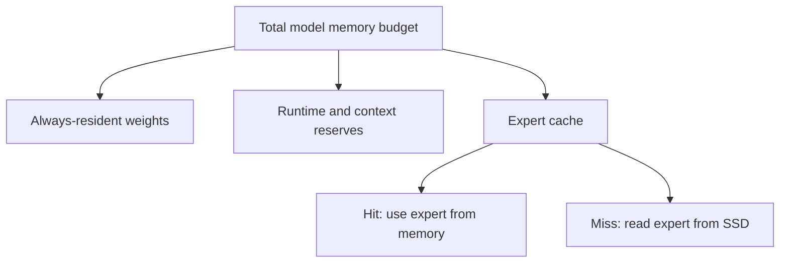

# Can more RAM make GLM faster?

**Yes, if it keeps useful experts away from the disk.** But the number shown at
startup may count only the weights that always stay resident. It is not
necessarily the total memory used during an answer.



## What your installed planner estimates

Read-only inspection on 18 October 2026, installed Colibri commit
`bf2442915d6e3dd4cdfd2eb9c2a3d2aa44a25850`, model
`~/colibri-models/glm-5.3`, default planner context/settings:

| Total RAM budget | Resident weights | Runtime/reserves | Expert-cache allowance | Planned slots/layer |
|---|---:|---:|---:|---:|
| 20 GB | 11.60 GB | 6.27 GB | 2.13 GB | 1 |
| 24 GB | 11.60 GB | 6.27 GB | 6.13 GB | 3 |

These are **planner estimates**, not observed generation allocations, cache hit
rates or speed measurements. Cache slot rounding and engine policy affect actual
allocation. The model has about 407.69 GB of routed expert weights on disk.

`--ram 20` is the **total budget**, not 20 GB of extra experts. Giving the cache
20 GB on top of everything else would exceed this Mac's practical headroom.

## Check it yourself without loading the model

```sh
~/Code/colibri/c/coli plan \
  --model ~/colibri-models/glm-5.3 --ram 20
```

Do not assume increasing the budget increases the cache: explicit cache caps,
pins and Metal-specific policy may limit it. Check the runtime's actual cache
capacity message. Colibri's `CAP_RAISE` policy can also matter; change it as a
separate test rather than silently changing several knobs.

## Our proposed memory experiment

First record the current command, context, backend, real memory peak and expert
hit rate. Use that actual configuration as baseline. A 10 GB total budget is not
a useful GLM test here: the planned resident weights alone exceed it.

Then try **20 GB**, and only if headroom permits **22 GB and 24 GB** total budgets.
Keep the same prompts, token count, backend and context. Alternate baseline and
candidate runs, warm the cache consistently, and capture:

- decode tokens/s and total response time;
- actual expert-cache capacity, hit rate and bytes read;
- total memory pressure, compression and swap changes;
- output/quality checks.

Stop increasing the budget if compression/swap rises or latency regresses.
The best budget is the fastest measured operating point, not the biggest one.
A Metal issue reports cache/residency overhead causing larger caches to lose;
macOS compression can also consume the gains. Those are reasons to measure,
not proof that a larger cache will lose on this Mac.

No GLM settings have been changed and this GLM sweep has not been run. The first
OLMoE runner is resident MLX; it does not yet implement these GLM memory sweeps.

Sources: [Colibri RAM budget implementation](https://github.com/JustVugg/colibri/blob/main/c/colibri.c),
[Metal cache discussion](https://github.com/JustVugg/colibri/issues/379),
[macOS memory planner discussion](https://github.com/JustVugg/colibri/issues/1614).
