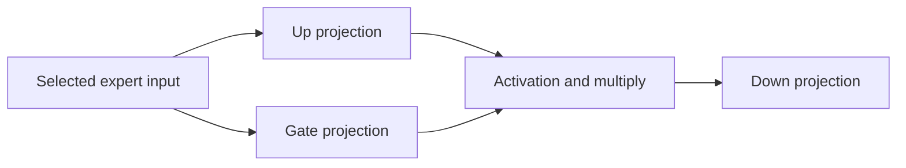
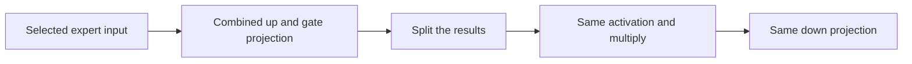

# More experiments: measure the trade, not just the headline

18 October 2026, the same small resident OLMoE checkpoint on Metal.
Every campaign uses three rounds and up to 128 output tokens on five prompts.
These experiments do not measure GLM streaming performance.

## Your steadier benchmark

[Published campaign](../published-results/20261017T163907.740295Z/by-prompt.md).
Baseline median decode was 201.0 tokens/s. Both alternative prefill chunk sizes
were within about 0.1% of baseline decode throughput. On the long prompt,
1024-token chunks had median first-token latency 0.454 s versus baseline 0.506 s;
256-token chunks took 0.668 s. Both changed long-prompt outputs. The first
baseline long-prompt request was slower than its repeats, so warming still matters.

## KV-cache quantization

[Raw results](../published-results/20261017T164710.744425Z/by-prompt.md).
This changes the precision of stored attention keys/values, not the model weights.

| Variant | Median paired decode change across prompts | Long-prompt decode | Long-prompt peak GPU GB | Output |
|---|---:|---:|---:|---|
| baseline | reference | 141.4 tok/s | 4.64 | reference |
| 8-bit KV | -0.4% | 160.6 tok/s | 4.59 | changed |
| 4-bit KV | +2.6% | 172.8 tok/s | 4.50 | changed |

The long-prompt gains are more interesting than the mixed-workload median, but
prompt processing became a little slower and outputs changed. We need held-out
quality evaluation and longer-context tests before recommending this setting.

## Grouping tokens by selected expert

[Diagnostic campaign](../published-results/20261017T164833.914769Z/by-prompt.md).
MLX normally groups when at least 64 expert indices are selected. We tried
always grouping and never grouping, keeping the same routing and weights.

Always grouping matched all tested output tokens and measured about 2.8% slower.
Never grouping changed outputs and increased first-token latency. A separate
quantized-expert check found max absolute deviation 0.001304 on a synthetic
batched case, failing the 1e-4 numerical tolerance. It is kept under
`variants/rejected/`, excluded from default campaigns. The passing regression
suite tests always-grouping; it does not endorse never-grouping.

One short GPU correctness test overlapped this diagnostic campaign. Do not use
its small speed differences as a reliable ranking. No winner is claimed.

## Fuse gate and up projections

[First fused campaign](../published-results/20261017T165036.378464Z/by-prompt.md).

The PoC packs up and gate matrices together and issues one projection operation:

The first version matched all output tokens and passed synthetic quantized
expert checks. Median paired decode improved only 0.85%, while long-prompt
peak allocation rose from 4.64 to 7.15 GB. This is not worth adopting as-is.
A follow-up replaces original matrices with views into the packed matrices so
we can test the operation without permanently holding duplicate weights.

All speed percentages are observed point estimates, not statistical guarantees.
Public archives contain exact settings, generated tokens, failures and logs.

## Compact fusion follow-up

[Compact fusion results](../published-results/20261017T165212.334140Z/by-prompt.md).
Replacing originals with views removed most duplicate allocation. All output
sequences matched baseline over three rounds. The paired median decode ratio
was **1.0121** (+1.21%). Long-prompt peak GPU allocation was **4.737 GB** versus
**4.644 GB** for baseline, instead of 7.152 GB in the first implementation.
Long-prompt first-token latency was about 0.522 s versus 0.524 s for this
campaign's baseline (inspect the raw rows for exact values).

This small gain needs more repetitions and workload coverage before promotion.
The default baseline remains unchanged. Packing happens on the warmup request;
its transient allocation and packing cost are not included in measured request
medians. Cold-load/first-use behavior needs a separate comparison.

Validation: seven tests passed with `COLIBRI_GPU_TESTS=1`, including quantized
expert comparisons for single-token and batched shapes. The complete real-model
campaign also checked output token equality. No GLM service settings were changed.
