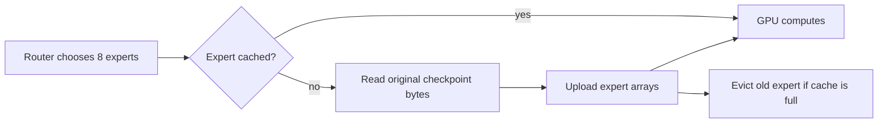

# More experts in memory: a controlled experiment

The resident baseline already keeps every OLMoE expert in GPU memory. A streaming
engine deliberately releases those expert arrays after loading. It reads original
checkpoint bytes when an expert is missing and retains a limited cache.



We compare 8, 32 and 64 retained experts per layer, with identical 512-token prefill
chunks. There are 64 experts per layer and 16 layers. LRU evicts the least recently
used expert. LFU evicts the least frequently requested expert; ties use cache order.
Counters operate per projection (up, gate, down), not per complete expert.

**This is a learning implementation, not a fast storage engine.** Python reads,
GPU-to-CPU routing synchronization, array uploads and packing add overhead.
Each forward temporarily gathers all experts needed by that batch. This scratch
allocation can exceed retained-cache capacity, especially during prefill. Model
startup also loads the complete model before releasing experts. It cannot yet
boot a model larger than RAM.

The packed-64 variant repacks a complete cache once, frees its separate rows,
and then uses the original expert indices directly. It tests how much repeated
staging costs. It eventually becomes resident; it is not a smaller-memory solution.

Telemetry records cumulative requested bytes, read calls, cache hits/misses,
time inside pread, and retained expert bytes after each request. Requested bytes
are **not physical SSD bytes**: this 3.89 GB checkpoint can fit in the OS page cache.
Read timing excludes GPU uploads, packing and Python overhead. Peak GPU allocation
is not total process or system memory. Warmup is included in cumulative counters.

Weight values and routing are preserved, but compacting expert batches changes
GPU matrix shapes. Floating-point differences can change greedy token decisions.
We report token mismatches and do not label these variants exact execution wins.
A speed measurement is not a quality evaluation.

## Run the cache experiment

```sh
.venv/bin/python bench.py run --variants variants/baseline.json variants/stream-lru-8.json variants/stream-lru-32.json variants/stream-lfu-32.json variants/stream-lru-64.json --rounds 3 --tokens 64
```

## Techniques still to test

| Technique | What it might improve | Required next step |
|---|---|---|
| Reuse staging buffers and grouped reads | Streaming overhead | Replace repeated uploads/packing; measure end-to-end |
| Asynchronous expert prefetch | Hide disk waits | Record useful vs wasted reads; compare on/off |
| Prompt lookup / draft speculative decoding | Verify several proposed tokens together | Add acceptance and cache-rollback checks |
| EAGLE / DFlash / native MTP | Better draft proposals | Find a trained head compatible with the exact target |
| Prefix cache | Repeated-prefix first-token time | Separate repeated-prefix workload |
| Continuous batching | Multiple users' aggregate throughput | Record per-user latency too |
| Lower-bit weights / TurboQuant-like KV | Reduce memory traffic | Quality evaluation and supported kernels |
| NPU or CPU/GPU split | Use more hardware | Measure transfers and total latency |

MLX-LM's [generation implementation](https://github.com/ml-explore/mlx-lm/blob/main/mlx_lm/generate.py)
provides speculative decoding with cache rollback; this does not make any arbitrary
pair of tokenizers or draft heads compatible. The
[flash-moe experiments](https://github.com/danveloper/flash-moe) also report negative
prefetch results: overlap can contend with GPU memory bandwidth. We will measure
these ideas instead of assuming that combining them is faster.

## Measured cache sweep

Campaign `20261017T165844.803566Z`: three rounds, five prompts, up to 64 generated
tokens, greedy decoding, identical prefill chunks. Every run completed.

| Variant | Median decode tok/s | Long-prompt peak GPU GB | Cumulative requested weight GB |
|---|---:|---:|---:|
| Resident baseline | 199.00 | 4.644 | 0 additional |
| LRU 8 | 28.38 | 1.495 | 160.37 |
| LRU 32 | 48.58 | 2.770 | 66.33 |
| LFU 32 | 48.08 | 2.779 | 58.14 |
| LRU 64 | 69.53 | 4.499 | 3.62 |

Peak values are medians for the long prompt; requested bytes are medians of the
cumulative worker counter after its final request, including warmup. They are not
per-token bytes or physical disk traffic. LFU requested about 12% fewer bytes than
LRU at capacity 32 but did not improve overall speed. Host synchronization and
packing remain expensive even when every expert is cached.

Each streaming variant differed from the paired baseline on the explanation
prompt at generated token index 36 (zero-based). The other four measured prompts
matched at this token cap. All streaming capacities produced the same token
streams within this campaign. This suggests an execution-shape effect rather
than eviction corruption, but does not establish full-model numerical equivalence.
The separate synthetic Metal test reconstructs original expert tensors, forces
eviction/reload and checks outputs within 1e-4 tolerance with the capacity bounded.

The earlier one-round, 32-token smoke campaign `20261017T165748.349585Z` used
256-token prefill for streaming versus 512 for baseline. It is retained as a
diagnostic, not the controlled comparison. During the main sweep an opt-in packed
cache path was added; it remained disabled in every sweep variant. Exact plugin
snapshots are retained per worker. The runner now freezes all plugin source at
campaign start to prevent later edits from affecting subsequent workers.

See [public raw comparison](../published-results/20261017T165844.803566Z/summary.md).

## Pack once instead of staging every call

Campaign `20261017T170136.134210Z`: three rounds, up to 128 generated tokens.
Packed-64 achieved 86.38 median tok/s versus its paired resident baseline 195.49
(paired median ratio 0.442). There were no failed runs; output tokens differed.
It is not an overall speed win. Layers reach full cache at different times, so
short prompts still pay staging costs. On the final long prompt, after the caches
fill, decode reached 142.28 versus 141.07 tok/s for baseline, with the same reported
4.644 GB peak GPU allocation. That small difference is not a proven speedup.

This isolates a useful lesson: a cached expert still needs an efficient execution
layout. Retaining it in Python objects and rebuilding GPU batches each call is
expensive. Packing eventually restores resident execution, but also resident memory
use. A practical limited-memory engine needs reusable buffers and fewer transfers.
See [raw packed-cache comparison](../published-results/20261017T170136.134210Z/by-prompt.md).

All eight tests passed with real Metal enabled, including source-byte reconstruction
and eviction. `make bench-cache` reruns all five cache variants against baseline.
