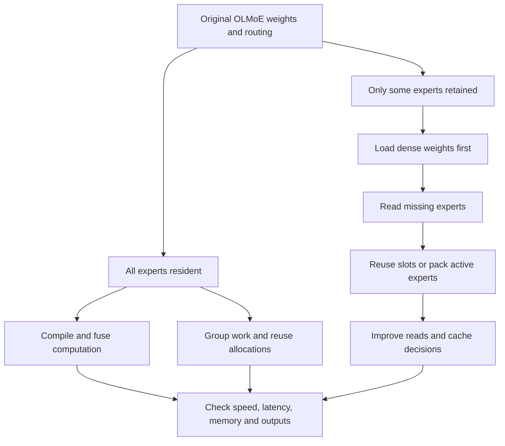
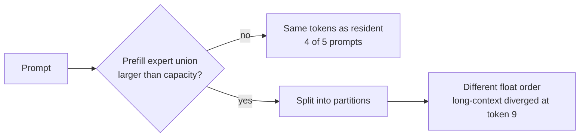
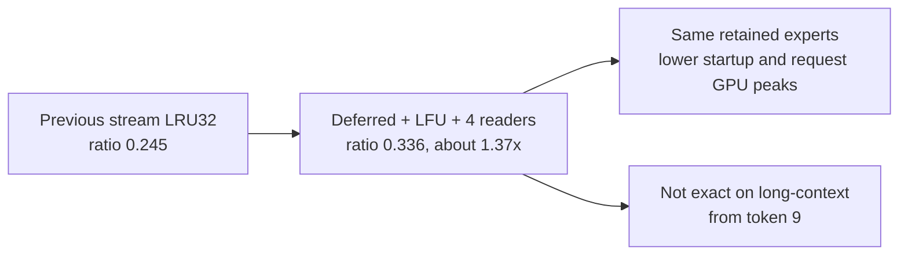

# Two objectives, two scorecards

We are testing resident inference and expert streaming separately. A faster
resident OLMoE result does not establish a faster disk-streamed GLM result.

## Resident experiments

The first screen ran three rounds and up to 128 generated tokens per prompt.
All 30 worker runs succeeded. Every variant matched its paired baseline's output
tokens on this workload.

| Change | Paired median decode ratio | Interpretation |
|---|---:|---|
| Compact fusion + compilation | 1.0086 | Small candidate gain, needs confirmation |
| Compilation alone | 0.9981 | No demonstrated gain |
| Compact fusion alone | 0.9938 | No demonstrated gain in this screen |
| Allocator cache 256 MiB | 0.9939 | No demonstrated gain |
| Allocator cache off | 0.9902 | Slightly slower |
| Group all expert work | 0.9647 | Slower |
| Group thresholds 32/128/256 | 0.9977–0.9986 | No demonstrated gain |

Compilation plus fusion raised worst request GPU allocation from 4.644 to 4.737 GB.
Median model-load plus first warmup token was 0.480 s, versus baseline 0.345 s.
It therefore does **not** improve every aspect, despite a small steady-state gain.
These load/first-use measurements exclude Python imports and process startup.
Allocator-cache variants test allocation reuse indirectly; they do not implement
custom resident activation buffers.

The lossless checkpoint preparation ran on CPU/storage during part of this broad
screen. Finalists need a clean confirmation campaign after implementation work.
See [raw resident screen](../published-results/20261017T171031.211076Z/analysis.md).

## Streaming changes

The previous implementation loaded the complete model before removing experts.
The new implementation requests lazy loading, deletes expert parameter graphs,
and evaluates dense weights only. In the first real-model smoke, startup peak GPU
allocation fell from 4.110 to 0.268 GB. This does not measure every host allocation
or prove compatibility with a checkpoint larger than RAM.

Two execution layouts are tested:

- Fixed GPU banks: replace missing expert slots, then remap the original routing
  indices. Indexed updates may copy buffers; there is no zero-copy claim.
- Compact active batches: retain expert rows and pack only experts used by the
  current batch. This tests whether copying a smaller active set is cheaper.

Prefill is partitioned when its selected expert union exceeds cache capacity.
A partition never uses more distinct experts than its capacity. The original
activation order is restored afterward. Retained memory is bounded, but bank
updates, loaded bytes, prefetch records and outputs require additional memory.
Measure actual peaks rather than treating retained weight bytes as total RAM.

The original checkpoint scatters the nine tensors belonging to each expert.
`prepare_expert_layout.py` copies them into contiguous records and verifies each
of all 9,216 tensors byte-for-byte. The original quantization does not change.
Packing creates a separate ignored local file, not a published model conversion.

The streaming matrix isolates original versus packed layout, separate versus
merged reads, 1/2/4/8 read workers, LRU/LFU/hybrid eviction, cache capacities,
temporal prefetch and unequal per-layer allocation at an equal total budget.
The prefetch predictor picks a frequently seen absent expert. It is a modest
temporal predictor, not a trained next-layer routing predictor.

The deferred-synchronization ablation removes explicit bank-upload and decode
completion waits where downstream dependencies already ensure correct order.
Prefill partitions still finish before reusing their banks. Its CPU upload/compute
timers measure enqueue time, not completed GPU time. End-to-end request timing
remains synchronized by the benchmark harness.

## Rules for a useful conclusion

For the resident objective, report decode, prefill, first token, first use, model
load and peak memory. Record the worst affected prompt, not just a pooled median.
A candidate with a memory or latency regression is a tradeoff, not an all-aspects win.

For streaming, compare equal retained byte budgets and report actual peak memory,
requested bytes per output token, read calls, hit rate and end-to-end latency.
Requested bytes per generated token includes prompt prefill unless explicitly
stated otherwise. It is not physical SSD traffic. OS page cache is uncontrolled.

Both implementations retain the original weights and routing policy, but different
GPU matrix shapes and ordering can change floating-point results and greedy token
choices. Numerical module tests, output equality and a full quality evaluation
are different levels of evidence. No silent approximation is accepted as an exact
execution improvement. Baseline remains available for every comparison.

## Resume or reproduce

See [the live experiment handoff](../EXPERIMENT_HANDOFF.md) for current campaigns,
commands, tests, pending work and explicit limitations. It is the takeover entry
point if the current agent hits a usage limit.

Run the registered matrix serially with `make bench-matrix`. Use
`make bench-resident` or `make bench-streaming` for one objective. Both default
to three rounds and 128 generated tokens. For a broad screen use
`make bench-streaming ROUNDS=2 TOKENS=32`, then confirm candidates with longer
outputs. Streaming prepares and verifies the lossless layout first. No model
weights or raw downloads are published.

## Broad streaming screen

Campaign `20261017T171558.896165Z` completed 32 workers, two rounds, five prompts,
up to 32 generated tokens. All workers succeeded. This is a screen: the earlier
implementation's known divergence at token 36 would be invisible at this cap.

| Variant | Median decode tok/s | Retained expert GB | Worst request GPU GB |
|---|---:|---:|---:|
| Previous stream LRU32 | 47.76 | 1.812 | 2.770 |
| Fixed slots, original layout, lazy | 45.57 | 1.812 | 2.626 |
| Fixed slots, packed/grouped LRU32 | 46.11 | 1.812 | 2.626 |
| Fixed slots, LFU32 | 51.15 | 1.812 | 2.626 |
| Fixed slots, hybrid32 | 51.11 | 1.812 | 2.626 |
| Fixed slots, four readers | 48.46 | 1.812 | 2.626 |
| Fixed slots, temporal prefetch | 46.21 | 1.812 | 2.626 |
| Fixed slots, capacity8 | 23.73 | 0.453 | 1.135 |
| Fixed slots, capacity48 | 68.63 | 2.718 | 3.421 |

The fixed-slot variants differed from resident output tokens. Do not present these
as exact numerical execution replacements. Synthetic numerical tests passed,
which is useful evidence but not a full-model quality evaluation.

At equal capacity32, merging packed reads reduced measured read calls from 97,407
to 6,300 with identical requested bytes. The speed improvement was small in this
OS-cache-uncontrolled test. Four I/O workers helped modestly; eight did not add a
clear gain. Temporal prefetch increased cumulative requested bytes from 44.95 to
55.19 GB without a useful speed gain. Its CPU record buffers are additional to GPU
memory, and GPU peak alone does not capture that overhead.

Lazy versus eager loading retained the same runtime banks but startup peak GPU
allocation was 0.268 versus 4.110 GB. This is a concrete startup-memory improvement.
Read bytes are requested application bytes; **none of these are physical SSD
throughput measurements**. See the [extended raw screen report](../published-results/20261017T171558.896165Z/analysis.md).

The equal-budget allocation pilot produced capacities
`[34,37,34,32,31,29,29,29,31,33,35,31,32,32,32,31]`: exactly 512 slots, matching
uniform32. It follows a miss-pressure heuristic, not an optimal allocation.
Its generating worker hash is recorded in the variant description.

## Deferred-synchronization and unequal-allocation screen

Campaign `20261017T172211.404589Z` ran one round, five prompts, up to 32 tokens.
All seven workers succeeded. It is a one-round screen, not a ranking.

| Variant (all 32 slots/layer, 512 total) | Decode tok/s | Paired ratio | Requested bytes/output token |
|---|---:|---:|---:|
| Previous stream LRU32 | 47.84 | 0.238 | 271.0 MB |
| Fixed slots, deferred waits | 54.97 | 0.278 | 239.4 MB |
| Compact active batches, deferred waits | 47.64 | 0.239 | 239.4 MB |
| Fixed slots, unequal allocation | 46.58 | 0.235 | 237.8 MB |
| Compact, deferred, unequal allocation | 47.14 | 0.244 | 237.8 MB |
| Fixed slots, deferred + LFU + four readers | 66.48 | 0.352 | 222.5 MB |

Removing redundant waits helped fixed banks but not compact batches. The combined
deferred/LFU/four-reader variant was the best equal-budget candidate. The unequal
per-layer allocation requested slightly fewer bytes but was **not faster** than
uniform32: a negative result for this heuristic.

Per-prompt output comparison: every new slot and compact variant reproduced the
resident tokens exactly on four of five prompts. All diverged only on
`long-context`, at generated token index 9. That prompt's prefill must be split
into capacity-sized partitions. The earlier streaming implementation instead
builds one temporary active batch that may exceed retained capacity, and matched
exactly; its memory is therefore less strictly bounded during prefill. This points at partitioned prefill ordering as the
source of difference, but it is an inference, not a quality evaluation.
See the [raw screen report](../published-results/20261017T172211.404589Z/analysis.md).

## Confirmation campaigns

Both ran after implementation work stopped, one at a time on an idle GPU.
Ratios are paired: same round, same prompt, divided by that round's baseline.

### Resident: no all-aspects win

Campaign `20261017T190252.063406Z`: three rounds, five prompts, up to 256 tokens.
All 12 workers succeeded, and every variant matched the resident tokens on every
prompt in every round.

| Variant | Median paired decode ratio | Range across prompts and rounds | Load + first token s | Worst request GPU GB |
|---|---:|---:|---:|---:|
| Baseline | 1.000 | — | 0.364 | 4.644 |
| Compact fusion | 1.009 | 0.993–1.036 | 0.459 | 4.737 |
| Compilation | 1.006 | 0.973–1.029 | 0.360 | 4.644 |
| Compilation + fusion | 1.008 | 0.977–1.041 | 0.443 | 4.737 |

The gains are under 1%. Baseline median itself drifted from about 198 to 191 tok/s
between campaigns, so differences this small are not robust. Fusion adds 0.09 GB
peak GPU and about 0.1 s first use. **Conclusion: no resident variant improves
every aspect.** Compilation alone is a neutral, exact option.

### Streaming: deferred waits + LFU + four readers is the best equal-budget candidate

Campaign `20261017T190508.176615Z`: three rounds, five prompts, up to 128 tokens.
All 21 workers succeeded. Every streaming variant retains 32 experts per layer
(512 slots, 1.81 GB of expert weights).

| Variant | Median decode tok/s | Paired ratio | Worst paired ratio | TTFT s | Startup GPU GB | Worst request GPU GB |
|---|---:|---:|---:|---:|---:|---:|
| Resident baseline | 189.3 | 1.000 | — | 0.052 | 4.110 | 4.644 |
| Previous stream LRU32 | 44.3 | 0.245 | 0.206 | 0.362 | 4.110 | 2.770 |
| Fixed slots LRU32 | 41.5 | 0.240 | 0.189 | 0.547 | 0.268 | 2.626 |
| Fixed slots LFU32 | 39.2 | 0.242 | 0.169 | 0.470 | 0.268 | 2.624 |
| Fixed slots, deferred waits | 48.1 | 0.269 | 0.212 | 0.485 | 0.268 | 2.632 |
| Fixed slots, unequal allocation | 43.8 | 0.238 | 0.209 | 0.507 | 0.268 | 2.633 |
| **Deferred + LFU + four readers** | **58.2** | **0.336** | **0.261** | 0.366 | 0.268 | 2.618 |

Against the previous streaming implementation, the combined variant is about
1.37× faster at the same retained budget. It was faster on every prompt, had a
better worst case, a 0.27 GB instead of 4.11 GB startup GPU peak, a lower request
GPU peak and similar first-token latency. It still runs at about one third of
resident speed.

Output tokens, with 128 generated tokens:

- Previous stream LRU32 diverged on `explain` at token 36 in all three rounds,
  matching the earlier report, and matched the other four prompts.
- Every fixed-slot variant matched `explain`, `code`, `reason` and `story`
  exactly, and diverged on `long-context` at token 9 in all three rounds.

Neither streaming implementation is exact. They differ on different prompts,
which suggests floating-point ordering effects rather than a single bug. A quality
evaluation is still needed.

Two caveats for interpretation. LFU alone was not faster than LRU here, and the
unequal allocation again lost to uniform32. The winning combination has not been
fully ablated: deferred + four readers without LFU, and deferred + LFU with one
reader, are untested. OS page cache remains uncontrolled; none of these are
physical SSD measurements.

Raw reports: [resident](../published-results/20261017T190252.063406Z/analysis.md),
[streaming](../published-results/20261017T190508.176615Z/analysis.md).
See [candidate next experiments](10-next-experiments.md).
