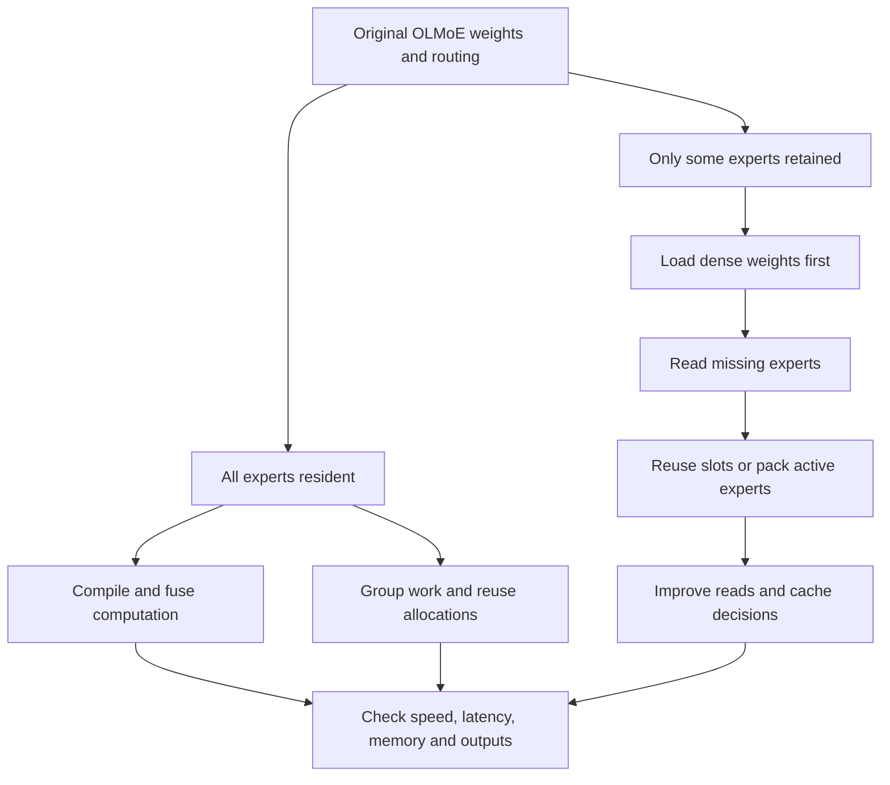

# Two objectives, two scorecards

We are testing resident inference and expert streaming separately. A faster
resident OLMoE result does not establish a faster disk-streamed GLM result.

## Resident experiments

The first screen ran three rounds and up to 128 generated tokens per prompt.
All 30 worker runs succeeded. Every variant matched its paired baseline's output
tokens on this workload.

| Change | Paired median decode ratio | Interpretation |
|---|---:|---|
| Compact fusion + compilation | 1.0086 | Small candidate gain, needs confirmation |
| Compilation alone | 0.9981 | No demonstrated gain |
| Compact fusion alone | 0.9938 | No demonstrated gain in this screen |
| Allocator cache 256 MiB | 0.9939 | No demonstrated gain |
| Allocator cache off | 0.9902 | Slightly slower |
| Group all expert work | 0.9647 | Slower |
| Group thresholds 32/128/256 | 0.9977–0.9986 | No demonstrated gain |

Compilation plus fusion raised worst request GPU allocation from 4.644 to 4.737 GB.
Median model-load plus first warmup token was 0.480 s, versus baseline 0.345 s.
It therefore does **not** improve every aspect, despite a small steady-state gain.
These load/first-use measurements exclude Python imports and process startup.
Allocator-cache variants test allocation reuse indirectly; they do not implement
custom resident activation buffers.

The lossless checkpoint preparation ran on CPU/storage during part of this broad
screen. Finalists need a clean confirmation campaign after implementation work.
See [raw resident screen](../published-results/20261017T171031.211076Z/analysis.md).

## Streaming changes

The previous implementation loaded the complete model before removing experts.
The new implementation requests lazy loading, deletes expert parameter graphs,
and evaluates dense weights only. In the first real-model smoke, startup peak GPU
allocation fell from 4.110 to 0.268 GB. This does not measure every host allocation
or prove compatibility with a checkpoint larger than RAM.

Two execution layouts are tested:

- Fixed GPU banks: replace missing expert slots, then remap the original routing
  indices. Indexed updates may copy buffers; there is no zero-copy claim.
- Compact active batches: retain expert rows and pack only experts used by the
  current batch. This tests whether copying a smaller active set is cheaper.

Prefill is partitioned when its selected expert union exceeds cache capacity.
A partition never uses more distinct experts than its capacity. The original
activation order is restored afterward. Retained memory is bounded, but bank
updates, loaded bytes, prefetch records and outputs require additional memory.
Measure actual peaks rather than treating retained weight bytes as total RAM.

The original checkpoint scatters the nine tensors belonging to each expert.
`prepare_expert_layout.py` copies them into contiguous records and verifies each
of all 9,216 tensors byte-for-byte. The original quantization does not change.
Packing creates a separate ignored local file, not a published model conversion.

The streaming matrix isolates original versus packed layout, separate versus
merged reads, 1/2/4/8 read workers, LRU/LFU/hybrid eviction, cache capacities,
temporal prefetch and unequal per-layer allocation at an equal total budget.
The prefetch predictor picks a frequently seen absent expert. It is a modest
temporal predictor, not a trained next-layer routing predictor.

The deferred-synchronization ablation removes explicit bank-upload and decode
completion waits where downstream dependencies already ensure correct order.
Prefill partitions still finish before reusing their banks. Its CPU upload/compute
timers measure enqueue time, not completed GPU time. End-to-end request timing
remains synchronized by the benchmark harness.

## Rules for a useful conclusion

For the resident objective, report decode, prefill, first token, first use, model
load and peak memory. Record the worst affected prompt, not just a pooled median.
A candidate with a memory or latency regression is a tradeoff, not an all-aspects win.

For streaming, compare equal retained byte budgets and report actual peak memory,
requested bytes per output token, read calls, hit rate and end-to-end latency.
Requested bytes per generated token includes prompt prefill unless explicitly
stated otherwise. It is not physical SSD traffic. OS page cache is uncontrolled.

Both implementations retain the original weights and routing policy, but different
GPU matrix shapes and ordering can change floating-point results and greedy token
choices. Numerical module tests, output equality and a full quality evaluation
are different levels of evidence. No silent approximation is accepted as an exact
execution improvement. Baseline remains available for every comparison.

## Resume or reproduce

See [the live experiment handoff](../EXPERIMENT_HANDOFF.md) for current campaigns,
commands, tests, pending work and explicit limitations. It is the takeover entry
point if the current agent hits a usage limit.
