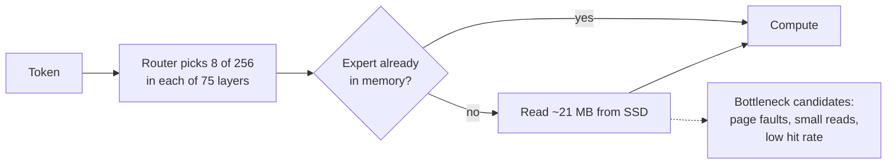

# Candidate next experiments

Research notes from 2026-10-18 on what to try after the two-track matrix.
External numbers are the authors' own claims on different hardware and models.
They are reasons to test, not results. Nothing here has run in this lab yet.

## Why the GLM gap is probably about reads, not compute

A rough size estimate, from published GLM-5 architecture numbers and the user's
~419 GB checkpoint (not measured here):

| Quantity | Estimate |
|---|---:|
| Routed experts | 256 per layer, 8 active + 1 shared, 75 MoE layers |
| One expert (3 × 6144 × 2048 weights at ~4.5 bits) | ~21 MB |
| Routed expert bytes per token if every expert misses | ~12.8 GB |
| Share of experts a ~20 GB cache could hold | ~5% |
| Read rate implied by 0.1 tok/s with mostly misses | ~1.3 GB/s |

Roughly 1.3 GB/s is far below the internal SSD's sequential read rate. That points
to read *method* and hit rate, not GPU math, as the first things to measure at GLM
scale. This is an inference from arithmetic. OLMoE speed ratios still do not
transfer to GLM.

## Ranked experiments

### 1. Offline routing-trace simulator (cheap, no GPU timing)

Record the selected expert IDs for every layer and token, then replay them through
cache policies in plain Python. This gives a **Belady optimal upper bound** (the
best any eviction policy could do with perfect future knowledge) at every budget,
with no timing noise. It shows how much room is left before more GPU campaigns.

- Compare per-layer LRU/LFU/hybrid, the S6 unequal split, a global shared pool,
  and Least-Stale (below) at 128/256/512/768 total slots.
- Uses only token IDs and router outputs. Telemetry already counts per-layer
  hits and misses; it needs a full ordered trace.
- Worth doing first: the S6 heuristic just failed, and a simulator explains why.

### 2. Global cross-layer pool with Least-Stale eviction

The SpecMD study ran on OLMoE and reported that LRU and LFU do poorly because
experts are used in fixed layer order. Its "Least-Stale" policy evicts experts
not used in the current forward pass first, in layer order. The authors report
2.6–8.6× fewer same-pass "collision" misses than LRU at 5% capacity.

Our caches are per layer, so Least-Stale mostly matters with one **shared** pool.
That is a dynamic version of the unequal allocation that just lost. Try it in the
simulator first, then in `stream_slots.py` at the same 512-slot budget.

### 3. Measure how large the long-context differences are

All new slot variants matched the resident tokens on four of five prompts and
diverged on `long-context` at token 9, where prefill is partitioned. Token equality
is a blunt test. Run teacher-forced comparisons: feed identical tokens, then record
max logit difference and KL divergence per position. Also try an
order-preserving partition (keep each expert's rows in the resident order) to see
whether the difference disappears.

### 4. Read method at real-SSD conditions (needs explicit approval)

Flash-MoE (C/Metal, Qwen3.5-397B on a 48 GB Mac) reports parallel `pread` at about
17.5 GB/s. It also reports memory-mapped expert access at about **0.2×** that
speed because of page-fault overhead, and llama.cpp-style runners often use
memory mapping. A controlled test on a dedicated copy of the packed OLMoE file would
compare mmap touch, single `pread`, parallel `pread`, and `F_NOCACHE` reads, with
physical I/O counters. This must not flush global caches or change the user's GLM
or Ollama setup. Ask before running.

### 5. Next-layer expert prediction: measure accuracy before wiring it in

Apply layer *l+1*'s router to layer *l*'s hidden state (Eliseev & Mazur style;
HOBBIT extends it to several layers). First log prediction precision and recall
only. Flash-MoE reports 31% accuracy and a 73% slowdown from prefetching on Apple
unified memory, because prefetch competes for memory bandwidth. Our temporal
prefetch also lost. Only wire it in if offline accuracy is high.

### 6. Prompt-informed warm start

ADEPT and MoE-CORE preload experts suggested by the prompt or its domain during
prefill. We already see every routed expert during prefill. Test whether keeping
prefill's most-used experts in the cache raises early decode hit rate.

### 7. Separate lossy track (label clearly, never mix with exact results)

- Fewer active experts or score-based substitution on low-score misses (MoE-CORE,
  SpecMD). SpecMD reports substitution performed poorly.
- Lower-bit expert copies as a miss fallback. Flash-MoE's 2-bit run was faster
  but corrupted JSON in tool calls.

These change model outputs by design and need a quality evaluation, not just
token equality.

### 8. Later, for GLM only

GLM-5.x has a multi-token prediction layer. SP-MoE and DraftExpert combine
speculative decoding with expert prefetch: draft tokens reveal which experts the
verifier will need. OLMoE has no MTP layer, so this cannot be tested here.

## Lower priority

- Kernel rewrites: Flash-MoE reports 12% from an FMA rewrite of its own 4-bit
  kernel. MLX's quantized kernels are already tuned, so expect less here.
- Compressing expert records: Flash-MoE reports LZ4 made things 13% slower.

## Sources

- [SpecMD: speculative expert prefetching study (OLMoE, Least-Stale)](https://arxiv.org/html/2602.03921v1)
- [MoE-CORE: layer-wise cache, routing-history replacement, cross-layer prefetch](https://arxiv.org/abs/2610.01950)
- [Flash-MoE on a 48 GB Mac: what helped and hurt](https://lilting.ch/en/articles/flash-moe-qwen35-397b-metal-inference)
- [ProMoE: proactive caching](https://arxiv.org/html/2410.22134v1)
- [SpecPrefetch](https://arxiv.org/pdf/2607.24787), [SPICE](https://arxiv.org/pdf/2608.21240), [SP-MoE](https://arxiv.org/html/2510.10302v2), [DraftExpert](https://www.alphaxiv.org/abs/2607.24434v1)
- [ADEPT two-stage offloading](https://www.researchgate.net/publication/400888358_Two-Stage_Expert_Offloading_for_Domain-Aware_MoE_Inference)
- [vLLM incremental expert offloading RFC](https://github.com/vllm-project/vllm/issues/38256)
- [DeepSeek V4-Flash MLX SSD offload](https://github.com/ssd-moe/deepseek-v4-flash-mlx)
- [GLM-5 technical report](https://arxiv.org/pdf/2602.15763), [GLM-5 architecture notes](https://glennklockwood.com/garden/GLM-5)
