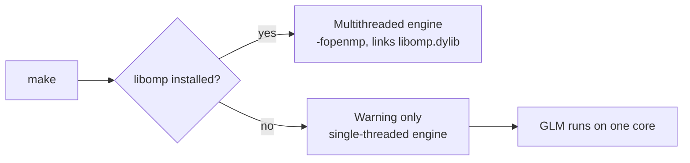
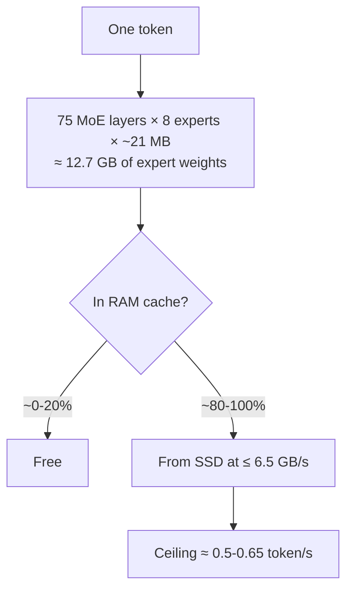
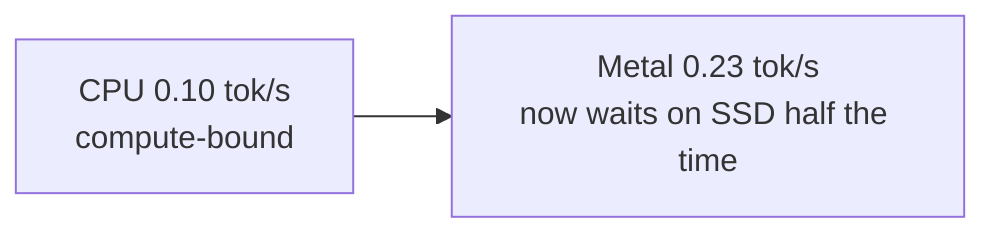
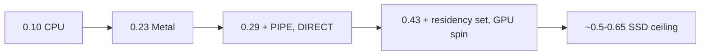
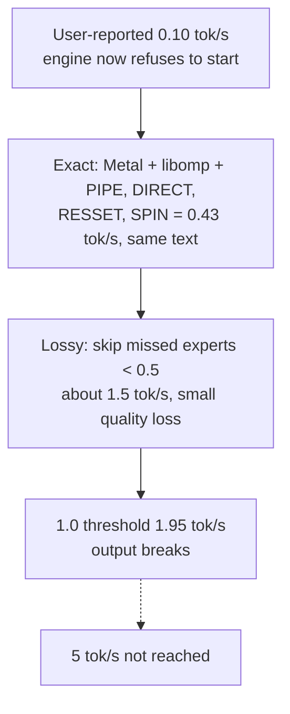
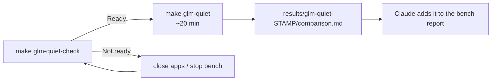

# GLM-5.3 on this Mac: what limits it

Live findings from 2026-10-18 while testing the user's real GLM-5.3 setup
(Colibri `bf244291`, model `~/colibri-models/glm-5.3`, int4 g64, 419 GB, Apple M6,
32 GB). This page grows as tests finish.

> **Busy test machine.** All GLM numbers here were measured on the owner's everyday
> Mac with many other processes running: ChatGPT/Codex, Claude, Steam, web browsers
> and other apps. They held roughly 14-22 GB of the 32 GB, so free RAM swung between
> about 10 and 17.5 GB, and macOS swapped some memory during tests. Less free RAM
> means a smaller expert cache, and other processes compete for CPU, GPU and SSD time.
> **Actual performance on a quieter machine may be better.** We have not measured how
> much better, so treat these results as conservative for this hardware.

## Finding 1: the installed engine was built without OpenMP (single-threaded)

The installed engine `~/Code/colibri/c/colibri` links only `libSystem`. It has
no OpenMP symbols, and its `.build-config` has no `-fopenmp`.

Why: Apple's clang ships without an OpenMP runtime. Colibri's Makefile looks
for Homebrew or MacPorts `libomp`, and when it finds none it prints a warning and
**silently builds single-threaded**: every `#pragma omp` is ignored. Expert
matrix math and parallel expert loading then use one CPU core.



Check any build:

```sh
otool -L ~/Code/colibri/c/colibri | grep libomp
```

No output means single-threaded. Fix (user-approved and done on 2026-10-18;
the user's own engine has **not** been rebuilt):

```sh
brew install libomp
make -C ~/Code/colibri/c clean glm          # CPU, multithreaded
make -C ~/Code/colibri/c clean glm METAL=1  # adds the Apple GPU backend
```

Test builds lived in separate clones. On 2026-10-18, at the user's request, the
installed engine was rebuilt with `METAL=1` and libomp (previous binary backed up to
`~/Code/colibri-engine-backup-20261018/`). Smoke test: 0.44 tok/s, same text.

## Finding 1b: even with libomp, Colibri uses 2 of 12 cores on the M6

Colibri sizes its OpenMP thread team from `hw.perflevel0`, assuming that is the
performance-core tier. The M6 has three tiers: 2 "Super", 4 Performance and 6
Efficiency cores, so Colibri used **2 threads**. Every run on this page used 2
threads unless it says otherwise. The owner's original setup had no OpenMP at all
(a local misconfiguration: libomp was not installed), so it used one.

`OMP_NUM_THREADS` overrides the default. Same prompt; output text was identical at
every thread count, and identical to the earlier runs.

| Setup | 2 threads (default) | 6 threads | 12 threads |
|---|---:|---:|---:|
| CPU-only, exact, tok/s | 0.12 | 0.24 | **0.27** |
| CPU-only, prompt reading (17 tokens) | 135 s | 51 s | **36 s** |
| Metal, exact, tok/s | 0.44 | 0.46 | 0.44 |
| Metal, skip < 0.50, tok/s | 1.56 | 1.84 | **1.91** |

Exact Metal runs are limited by the SSD, so threads do not matter there. With
skipping, the CPU-side share of each token fell from 26% to 9%, giving +22%.
Use `OMP_NUM_THREADS=12`. Whether the Efficiency cores help or just add heat was not
measured separately beyond 6 vs 12. This looks like a Colibri bug worth reporting
upstream (the `coli_physical_cores` heuristic in `omp_tune.h`).

## Finding 2: the installed engine is CPU-only

`coli doctor` reports "GPU detected but the engine is CPU-only". The engine was
built without `METAL=1`, so the Apple GPU is never used.

## Finding 3: there is no memory left for an expert cache

With the user's normal apps open, about 17.5 GB was available. Colibri's
automatic budget (88% of free RAM) came out at 15.4 GB. The engine needs:

| Part | GB |
|---|---:|
| Dense weights, always resident | 11.1–11.6 |
| Runtime reserve at 4,096 context | 6.3 |
| Runtime reserve at 1,024 context | 5.4 |
| One expert slot per layer (75 layers × ~21 MB) | ~1.6 |

At this moment the engine **refused to start** ("projected peak 19.0 GB ... exceeds
the 17.5 GB actually available"). Earlier runs that worked had essentially zero
expert cache, so every routed expert was read from SSD on every token.

## Finding 4: the SSD sets a hard ceiling

Colibri's `iobench`, random 21 MB expert-sized reads on the model shards:

| Readers | Uncached (`F_NOCACHE`) GB/s |
|---:|---:|
| 1 | 5.27 |
| 2 | 6.47 |
| 4 | 6.29 |
| 8 | 5.93 |
| 16 | 6.34 |

More than two readers adds nothing. Buffered reads measured 6.9–7.7 GB/s, but
part of that can come from the page cache.

## Why 5 token/s is out of reach without changing the model's math



The user's own routing history (`.coli_usage`, only ~136 tokens, so optimistic)
says pinning the hottest experts would serve:

| Expert cache | Share of expert reads |
|---|---:|
| ~5 GB (what this Mac can spare) | ~18-20% |
| ~25 GB | ~47% |
| ~100 GB | ~82% |

5 token/s needs about 64 GB/s of expert data. Exact-output tuning can at best
approach the ~0.5-0.65 token/s I/O ceiling. Faster than that requires lossy
changes (fewer or substituted experts, lower-bit experts), more RAM, or a much
faster disk setup. Those are tested and labelled separately.

## Safety of these tests

Every test run uses `USAGE_SAVE=0`, `KVSAVE=0` and `--no-tune-profile`, so the
user's learned expert history, saved conversation and tuning profile are not
changed. Those files were backed up and hashed before testing. The user's Ollama
and Colibri configuration are not modified.

## Measured GLM speed

Greedy, prompt "Explain in two sentences why the sky is blue.", 17 prompt tokens,
24 generated tokens, RAM budget 18 GB, context 1,024, `PROF=1`. One run each, so
treat differences under ~10% as noise. OS page cache is uncontrolled.

| Engine / setting | Decode tok/s | Per token: SSD wait / expert math / attention |
|---|---:|---|
| Installed engine, automatic RAM | did not start | refused: not enough free RAM |
| Multithreaded CPU (libomp) | 0.10 | 2.2 s / 3.5 s / 3.2 s |
| **Metal GPU + libomp** | **0.23** | 2.2 s / 0.6 s / 1.5 s |



On the CPU the expert math and attention, not the SSD, dominated each ~10 s
token. Metal cut those to about 2 s, making SSD reads the largest share (49%).
The expert cache held one slot per layer, giving a 2% hit rate; each token
fetched about 12 GB. Metal attention time is mostly GPU scheduling (24.6 s of
34.5 s), not kernel work, which is a candidate for further tuning.

## Exact settings sweep (Metal engine)

Same workload as above. Every run produced the same 24 tokens of text as the CPU
engine, so none of these settings changed the output on this prompt.

| Setting added | Decode tok/s | Expert I/O share |
|---|---:|---:|
| Metal only | 0.23 | 49% |
| + `PIPE=1` (overlap reads with math) | 0.25 | 47% |
| + `DIRECT=1` (uncached reads) | 0.29 | 52% |
| + `COLI_METAL_RESSET=1` (Metal residency set) | 0.36 | 65% |
| `PIPE` + `DIRECT` + `COLI_METAL_SPIN=1` | 0.38 | 68% |
| `PIPE` + `DIRECT` with 4 readers | 0.30 | 55% |
| `PIPE` + `DIRECT` + `PILOT` prefetch | 0.29 | 53% |
| **All four: PIPE, DIRECT, RESSET, SPIN** | **0.43** | 76% |
| ... repeated | 0.44 | 75% |
| ... with 2 or 16 readers | 0.42 / 0.43 | 76-77% |
| ... with 2 cache slots per layer, RAM 20 GB | 0.44 | 75% |
| ... with `COLI_MMAP=1` (page cache as expert cache) | failed | GPU out-of-memory errors |



The best exact configuration is about **4.3× the CPU engine** and moves about
5 GB/s of expert data, close to the measured ~6.5 GB/s SSD maximum. What remains
is mostly SSD time. More readers, prefetch and one more cache slot per layer did
not help. The installed engine would need `METAL=1` and libomp, plus these
environment settings:

```sh
COLI_METAL=1 PIPE=1 DIRECT=1 COLI_METAL_RESSET=1 COLI_METAL_SPIN=1 OMP_NUM_THREADS=12 \
  coli chat --model ~/colibri-models/glm-5.3 --ram 18 --ctx 1024
```

`COLI_METAL_SPIN=1` keeps a GPU keep-alive running and costs power. `--ctx 1024`
limits conversation length; it was needed to fit in the memory left by other apps.
Free memory varied between 10 and 17.5 GB during testing, and the engine refuses
to start when its projected peak exceeds what is free.

## Lossy settings (change the model's computation)

Base: the best exact configuration. 48 generated tokens. These **change what the
model computes** and need a quality evaluation, not only a speed number.

- `DEGRADE_ZERO=1 DEGRADE_TAU=t`: when a routed expert is *not* in memory and its
  routing weight is below `t`, skip it instead of reading it from SSD.
- `CACHE_ROUTE=1`: swap low-ranked experts for ones already in memory.

| Setting | Decode tok/s | Expert loads skipped or swapped | Output vs exact |
|---|---:|---:|---|
| Exact | 0.43 | — | reference |
| Skip below 0.03 / 0.05 / 0.10 | 0.43 | 4 / 9 / 203 of ~27,600 | identical |
| `CACHE_ROUTE=1` (default and J=1, M=24) | 0.43 | 0% swapped | identical |
| Skip below 0.10 + `CACHE_ROUTE` | 0.43 | small | identical |
| **Skip below 0.20** | **0.55** | ~6,981 (~25%) | reworded; still correct and coherent |

GLM spreads routing weight across its eight experts, so thresholds up to 0.10
skip almost nothing. `CACHE_ROUTE` can only substitute an expert already in
memory, and with one cache slot per layer there is nearly nothing to substitute.

### Higher skip thresholds

| Skip threshold | Sky prompt tok/s | Code prompt tok/s | Expert loads skipped (sky) |
|---|---:|---:|---:|
| exact | 0.43 | 0.42 | 0 |
| 0.20 | 0.55 | 0.51 | 6,981 (~25%) |
| 0.30 | 0.91 | 0.89 | 16,666 (~60%) |
| 0.40 | 1.30 | — | 21,277 (~77%) |
| 0.50 | 1.57 | 1.46 | 23,163 (~84%) |
| 0.70 | 1.82 | — | 24,244 (~88%) |
| 1.00 (skip every missed expert) | 1.95 | — | 24,338 |


All of these answers stayed fluent and factually right on these two prompts, and
the code answer kept the same structure through 0.30. Once most expert reads are
skipped, attention and engine overhead become the bottleneck (at 0.50: SSD 39%,
attention 30%, other 26%). A few dozen tokens on two prompts is **not** a quality
evaluation; a short factual quiz follows.

At 0.70 the sky answer contained grammar errors; at 1.00 it fell into a loop
("and the air, and the air, ..."). That marks the breaking point.

### Short factual quiz

16 generated tokens max, greedy.

| Question | Exact | Skip < 0.50 | Skip < 0.70 |
|---|---|---|---|
| Capital of Australia | Canberra | Canberra | Canberra |
| 17 × 23 | 391 | 391 | 391 |
| Author of Pride and Prejudice | Jane Austen | Jane Austen | Jane Austen |
| Chemical symbol for gold | Au | Au | Au |
| "Thank you very much" in Japanese | ありがとうございます。 | ありがとうございました。 + unrequested notes | same + garbled notes |
| Decode tok/s (range) | 0.41-0.42 | 1.36-1.68 | 1.46-1.98 |

Facts survived, but instruction following degraded: with skipping, the model chose a
less fitting past-tense phrase and ignored "Japanese only". Five questions is a
smoke test, not a benchmark. Prompt processing (prefill) stays exact; skipping
applies only to generated tokens.

## Conclusions



- **Exact: about 4.3× (0.10 → 0.43 tok/s)**, identical text on every tested prompt.
- **Lossy: about 15× (→ ~1.5 tok/s)** with `DEGRADE_ZERO=1 DEGRADE_TAU=0.5`. Facts held
  in a five-question smoke test, but instruction following visibly degraded.
- **5 tok/s was not reached.** Even skipping every missed expert, which breaks the
  output, gave 1.95 tok/s. At that point attention and engine overhead dominate.

What 5 tok/s would need, none of which was tested here:

1. **Engine work on Metal attention.** About 70% of Metal attention wall time was
   GPU scheduling rather than kernel work. That is a code change in Colibri's
   Metal backend, not a setting.
2. **Much more RAM.** Colibri's own reports: 2.24 tok/s on an M5 Max and 1.83 on a
   128 GB Ryzen AI Max+ 395 for GLM-5.2. This lab's routing history suggests
   ~100 GB of expert cache serves ~82% of reads.
3. **A smaller model.** For example GLM-5.3-Flash (321B, ~195 GB int4 in Colibri's
   format). Its dense part alone (~18 GB BF16) would be tight on this Mac.

Raw per-run numbers and generated text: [published-results/glm-20261018](../published-results/glm-20261018/runs.csv).
All runs are single runs on an OS-page-cache-uncontrolled system with other apps
open. The test engines were built from Colibri `bf244291` in separate clones; the
user's installed engine was not rebuilt.

## Vulkan dense chain on the M6 (negative result)

Colibri's Vulkan backend can run every layer's dense work (attention, norms,
residual adds) on the GPU as one "dense chain", instead of Metal's per-layer
CPU↔GPU round trips. It had never run on an Apple GPU: Colibri's Vulkan instance
did not opt in to portability drivers, so the loader hid MoltenVK. A 2-line opt-in
([patch](../patches/colibri-moltenvk-portability.diff), test clone only) made it work.
Requires `brew install molten-vk vulkan-loader shaderc` (installed with approval).

| Engine | Exact tok/s | Skip < 0.5 tok/s | Why |
|---|---:|---:|---|
| **Metal, best settings** | **0.43** | **1.57** | reference |
| Vulkan chain, experts on CPU | 0.18 | — | CPU expert math 71% |
| Vulkan chain + 3 GB GPU expert tier | 0.13 | 0.43 | only ~3% of experts reached the GPU tier |
| Vulkan chain + Metal experts (both backends) | — | 0.60 | chain attention 78% of time |

All 78 layers' dense weights (8.6 GiB) fit on the device, and the host copy was
released, which raised the expert-cache hit rate. But the chain's GPU time per
token (~0.4 s) was no better than Metal's attention plus overhead, and prompt
processing was 3-6× slower (77-154 s vs 23 s for 17 tokens). Metal stays the
recommended backend on this Mac.

## Quiet-machine rerun (to do by the owner)

The results above come from a busy machine. `glm_quiet.py` repeats the key runs with
other apps closed, so the report can show how much the busy machine cost.



1. Close every app you can (ChatGPT/Codex, Steam, browsers, Claude desktop and so on).
   Keep only a terminal.
2. `make glm-quiet-check` changes nothing. It shows free RAM, swap, the largest
   apps still open, and whether a benchmark or Colibri engine is already running.
   "Ready" needs at least 20 GB free.
3. `make glm-quiet` takes about 45 minutes. It runs five cases twice each: exact and
   skip 0.3/0.5 on the sky prompt, exact and skip 0.5 on the code prompt. It then
   tries exact runs at 22 and 26 GB RAM budgets; Colibri refuses a budget that does
   not fit, and the refusal is recorded.
   It also runs the **original engine** (the CPU-only, single-threaded binary backed up
   before the rebuild) to measure the user-reported 0.10 tok/s start: once exactly as
   it was used (automatic RAM, default context), which may refuse to start, and once
   at `--ram 18 --ctx 1024`. These take 10-20 minutes each; `--skip-original` skips them.
   `make glm-quiet-full` also runs the full 144-run quality bench (hours).
4. Tell Claude the printed results folder. `comparison.md` lists busy vs quiet
   tok/s per case, whether the text matches the busy run, and conditions before
   and after.

Each case reuses a busy run's exact prompt, length and settings (`c9-best-combo`,
`l8-degrade-030`, `l10-degrade-050`, `q0-code-exact`, `q3-code-degrade-050`). Your
Colibri state is not changed. The tool never closes apps or stops processes for you.
