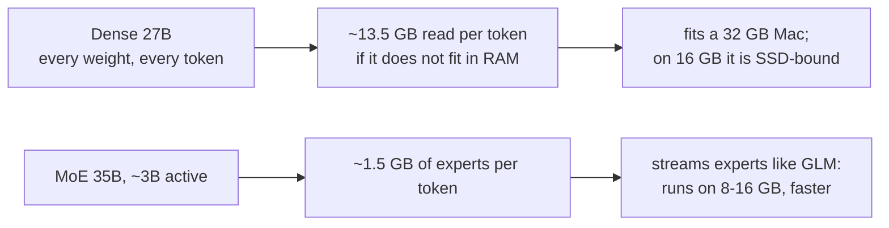
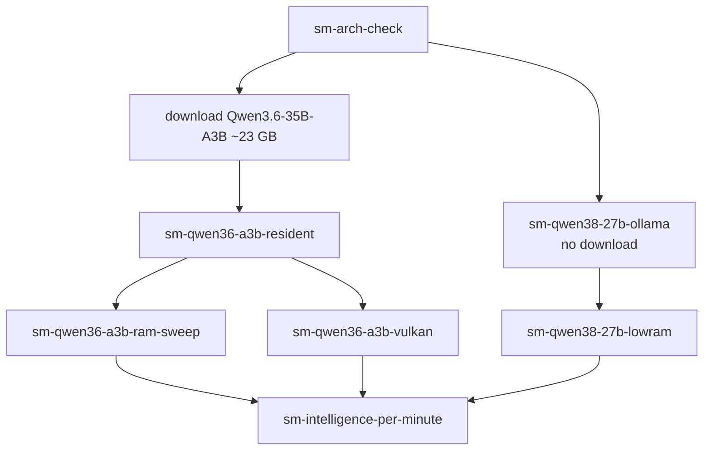

# Smaller models for lower-end machines (plan)

**Question:** can a smaller model, run the way we run GLM, give more useful intelligence
per minute of waiting on this Mac and on lower-end Macs (8-24 GB)?

Status: **planned, nothing run yet** (2026-10-18). Each experiment below is also an entry
in the [experiment log](12-experiment-log.md) (category `small-models`).

## The candidates

| Model | Total / active parameters | Kind | Colibri id | On disk (int4) | Published intelligence |
|---|---|---|---|---:|---:|
| GLM-5.3 (reference) | 744B / 40B | MoE, 256 experts, 8 active | `glm-5.2/5.3` | 419 GB | 45 |
| GLM-5.3-Flash | 321B / 18B | MoE | `glm53` | ~195 GB | 42 |
| **Qwen3.8-27B** | 27B / 27B | **dense** (no experts) | `qwen3.8-27b-colibri` | ~20 GB | **34** |
| **Qwen3.6-35B-A3B** | 35B / ~3B | **MoE** | `qwen36-35b` | ~23 GB | **18** |

Published intelligence = Artificial Analysis Intelligence Index v4.3.2 (reported by others,
not measured here; frontier reference: Claude Opus 5.5 = 58). Sources:
[GLM-5.3](https://artificialanalysis.ai/models), [Qwen comparison](https://artificialanalysis.ai/models/comparisons/qwen3-8-27b-vs-qwen3-6-35b-a3b).
Artificial Analysis lists Qwen3.8-27B as "3B active", but Colibri's architecture table
says it is dense ("one MLP per layer"); experiment `sm-arch-check` settles this from the
model's own config before anything depends on it.

The owner's "27B with 3B active" combines the two Qwen models. They behave very
differently on a small machine:

- **Qwen3.8-27B (dense)** is the smarter of the two (34 vs 18) and already installed in
  Ollama as `qwen3.8:27b-mlx` (18 GB). It fits in this Mac's RAM, so it does not need our
  streaming tricks here; on a 16 GB machine it would have to read most of its weights from
  the SSD for every token.
- **Qwen3.6-35B-A3B (MoE)** is the one that can use the GLM approach: only ~3B
  parameters (~1.5 GB at int4) are used per token, so expert streaming keeps it usable
  on 8-16 GB machines. Colibri reports 6.0 tok/s on a CPU and 9.9 tok/s on an integrated
  GPU (Vulkan), with 10-20 GB of RAM.

## How "lower-end machines" are simulated

This Mac (M6, 32 GB, ~6.5 GB/s SSD) stands in for smaller ones by capping what the engine
may use:

| Profile | RAM budget given to the engine | Threads | What it stands for |
|---|---:|---:|---|
| 8 GB Mac | 5 GB | 4 | base model, apps open |
| 16 GB Mac | 11 GB | 6 | common laptop |
| 24 GB Mac | 17 GB | 8 | upgraded laptop |
| This Mac | 24 GB | 12 | M6, 32 GB |

Caveat: a RAM cap does not reproduce a slower SSD or GPU. Base Macs often read at
~3 GB/s, half of this machine, so real low-end numbers will be lower where the SSD
dominates. Results will be labelled "simulated" until run on such a machine.

## Measurements (same as for GLM)

- **Speed:** generation tok/s and prompt reading time on the `sky` and `code` prompts.
- **Quality:** the 24-question quality bench (`glm_bench.py`), terse and normal styles,
  graded automatically and reviewed by hand, so results sit next to GLM's in
  [the bench](https://kakkoidev.github.io/colibri-poc/bench.html).
- **The comparison that matters:** correct answers per minute of waiting, next to the
  published intelligence score, for each model and machine profile.

## Experiments

| Id | What | Needs | Expected outcome |
|---|---|---|---|
| `sm-arch-check` | Read both Qwen configs: experts, active parameters, layers | nothing (config files only) | Confirms dense vs MoE |
| `sm-qwen38-27b-ollama` | Qwen3.8-27B through the installed Ollama MLX model: speed and quality bench | an Ollama backend for `glm_bench.py` (small code change) | Fast in RAM (tens of tok/s); quality close to GLM on these questions? |
| `sm-qwen36-a3b-resident` | Qwen3.6-35B-A3B on Colibri with every expert in RAM | ~23 GB download (`make glm-prep-qwen36`), a Colibri adapter for the bench tools | Upper bound for the MoE on this Mac |
| `sm-qwen36-a3b-ram-sweep` | Same, at the 5 / 11 / 17 / 24 GB profiles | as above | How speed falls as RAM shrinks; usable on 8 GB? |
| `sm-qwen36-a3b-vulkan` | Vulkan expert tier through MoltenVK vs CPU | our MoltenVK patch (engines/ clone) | Colibri saw 9.9 vs 6.0 tok/s on another integrated GPU |
| `sm-qwen38-27b-lowram` | Dense 27B on Colibri at the 11 / 17 GB profiles | Colibri conversion of Qwen3.8-27B | Shows why dense models fall off on small machines |
| `sm-intelligence-per-minute` | Combine quality bench, answer time and published scores for GLM-5.3, Qwen3.8-27B and Qwen3.6-35B-A3B per machine profile | the runs above | The table and chart this plan is for |

## What is needed before running

1. **Bench tools for other engines.** `glm_bench.py`, `glm_lab.py` and the run parser
   read Colibri's GLM engine output. The Qwen engine (`qwen36`) and Ollama print speed
   differently, so each needs a small adapter (parse its tok/s and prompt time, keep the
   same answer grading).
2. **A download, with your OK:** Qwen3.6-35B-A3B in Colibri format,
   `Kreuzzelg/qwen36-35b-a3b-colibri-i4-gs64` (~23 GB), prepared with
   `make glm-prep-qwen36` and shown in the lab app's Install screen.
3. **A quiet machine** for the speed numbers (≥ 20 GB free), like every other bench.

## Success criteria

- A model counts as a "lower-end option" if, on the 16 GB profile, it answers the terse
  quality bench at ≥ 20 of 24 correct in under a minute per answer.
- It counts as "extra intelligence on this Mac" if it beats GLM-5.3's correct answers per
  minute at equal or better quality on the bench. Published scores say GLM-5.3 is smarter
  (45 vs 34 vs 18), so the expected trade is speed for intelligence, measured, not assumed.
