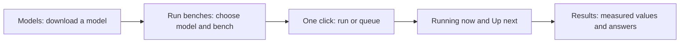

# Using the lab dashboard

Open http://127.0.0.1:8766. The three main pages follow the everyday tasks.

## Run benches

Choose a model, a bench and a start condition, then click **Run bench** or
**Add bench to queue** once. The button also resumes a paused queue; its label
says so before you click. The page confirms exactly what was added and prevents
another click on that selection. Use **Select multiple benches** for a campaign.

The plan shows what will run, its estimated duration and how many jobs are ahead.
A partially completed quality bench resumes unfinished answers. **Running now**
shows the active case and progress; expand it to see finished and upcoming cases.
**Up next** lists the first five waiting jobs, their order and any quiet-machine
condition. The queue link opens the full list, logs and reorder controls.
**Recently finished** includes failures as well as successful jobs.

The default condition starts when the GPU is free. The quiet condition waits for
20 GB free for two minutes. Bench types that intrinsically require a quiet run
keep that requirement. Estimates are approximate. Live status refreshes every
five seconds without resetting your model or bench selection.

## Results

Read saved speed, prompt time, expert hit rate and process memory values, then
compare quality scores and generated answers. The speed/RAM/thread link opens
all engine measurements with filtering. Coverage and bench definitions are
collapsed below the measured values. A failed job stays visible in queue history;
it does not become a successful measurement.

## Models

Check installed model folders and their measured disk usage. Available catalog
models retain their download confirmation and progress controls. **Move to Trash**
asks for confirmation and keeps saved benchmark results. The owner's original
model is protected, and an active or downloading model cannot be removed.
Models outside the managed catalog are listed separately.

Advanced navigation keeps the experiment, research and machine tools available.
