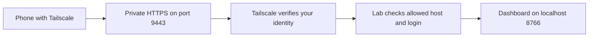

# Open the lab on another device

The lab starts automatically after macOS login using its LaunchAgent. If it exits,
launchd restarts it. The Mac must be awake, and an encrypted Mac must first be
unlocked after restarting.

Open **Open on phone** in the sidebar for the private HTTPS address and QR code.
Sign into Tailscale on your phone/tablet with the same account, then scan the code.
You can view results, queue/resume benches, and manage models with the same controls.



Setup on another Mac:

```sh
make lab-app-install
.venv/bin/python scripts/lab_app_phone.py enable
```

Tailscale must already be installed and signed in. This sets persistent Tailscale
Serve (`--bg`) on a dedicated HTTPS port, leaving other Serve ports alone. It does
not enable public Funnel access. The backend continues listening on loopback only.
The configured hostname and permitted Tailscale login live in git-ignored
`results/lab-app/access.json`; no account settings are committed.

```sh
.venv/bin/python scripts/lab_app_phone.py status
.venv/bin/python scripts/lab_app_phone.py disable
```

Disabling phone access removes only the lab's Serve port. It does not stop the
local dashboard or pi-local-harness. If port 9443 is occupied, choose a separate
port with `enable --port PORT`. Do not use a port already managed by another app.

The QR code is generated locally using the same MIT-licensed QR library as
pi-local-harness. No external QR service receives your address.
