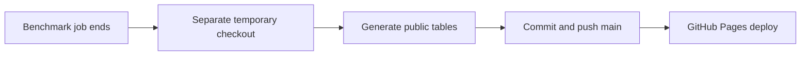

# Automatic public results

Results are committed and pushed after a lab benchmark job ends, then GitHub Pages
redeploys. There are no timed result commits. A background watcher checks the lab's
job completion state every 15 seconds; checking alone never commits anything.
Multiple jobs that finish together share one update. Failed jobs retain their
saved results, and interrupted benches can still be resumed. Already ended jobs
are checkpointed on first installation. Direct terminal benchmarks can be published
with the manual command below.

The historical performance story stays curated; the latest quality table is on
bench.html and all speed rows are in data/speed-runs.json.

Enable: `.venv/bin/python scripts/lab_results_sync.py install`

Publish now: `.venv/bin/python scripts/lab_results_sync.py once`

Disable: `.venv/bin/python scripts/lab_results_sync.py uninstall`

The login service is dev.kakkoi.glm-lab-results. Logs are in
results/lab-app/publisher.log. Network or authentication failures retry while the completed job is pending;
a rejected push never force-overwrites main. Your working tree and index are left
alone. Fetch tracking refs updates origin/main, so pull before your next code push.
Only saved JSON answers, speed CSV/output, and generated reports are shared. Raw
logs, models, access settings and other uncommitted files stay local. Home paths
are removed. Existing published answers survive local resume operations.
