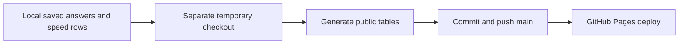

# Automatic public results

Saved quality answers and speed runs are published to main every five minutes while
the Mac is awake and logged in. GitHub Pages then redeploys. Running benches need
not finish first: answer counts show progress, not a completed campaign. Failed
answers remain visible. The historical performance story stays curated; the latest
quality table is on bench.html and all speed rows are in data/speed-runs.json.

Enable: `.venv/bin/python scripts/lab_results_sync.py install`

Publish now: `.venv/bin/python scripts/lab_results_sync.py once`

Disable: `.venv/bin/python scripts/lab_results_sync.py uninstall`

The login service is dev.kakkoi.glm-lab-results. Logs are in
results/lab-app/publisher.log. Network or authentication failures retry next cycle;
a rejected push never force-overwrites main. Your working tree and index are left
alone. Fetch tracking refs updates origin/main, so pull before your next code push.
Only saved JSON answers, speed CSV/output, and generated reports are shared. Raw
logs, models, access settings and other uncommitted files stay local. Home paths
are removed. Existing published answers survive local resume operations.
