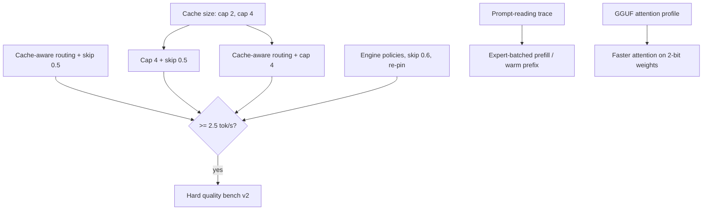

# What the benches tell us, and what to try next (2026-10-22)

Sources: `site/data/bench-compare.json` (9 quality benches), `site/data/speed-runs.json`
(107 engine runs), `site/data/findings.json`, the quiet-run campaign (`x-*` runs) and the
OLMoE streaming work in [08](08-expert-streaming.md) and [09](09-two-track-experiments.md).
All GLM timings come from the everyday (busy) Mac; differences under ~10% are noise.

## 1. Which GLM flavour, prompt style and cache level?

| Question | Answer | Evidence |
|---|---|---|
| Flavour | **Original int4 (v1).** | MTP head: 0.42 vs 0.44 tok/s exact, -10% with skipping. GGUF IQ3_XXS / IQ2_M: 0.33-0.35 tok/s exact, 0.64-0.73 with skip vs 1.87 for int4. No flavour beat int4 on quality either. |
| Prompt style | **Terse.** | 24/24 for every GLM setting; normal answers lose 3-7 points, mostly to the 128-token cap. Answer time 45-50 s vs 120-300 s. |
| Setting | **Skip 0.4-0.5 with 12 threads, terse** (changes output). | int4 terse: 24/24 at 1.25-1.44 tok/s; the decode bench speed run reaches 1.89 tok/s. Exact stays 0.41-0.44. |
| Cache / RAM | **18 GB is enough today; more RAM does nothing yet.** | 18 / 22 / 26 GB gave 0.40 / 0.41 / 0.42 tok/s and 2.1 / 2.8 / 3.6% hits, because the engine keeps **1 expert per layer** on a fast SSD. Untested until the cache size is forced (below). |

Two things the data says that matter more than the table:

- **For terse answers, prompt reading is the wait.** Of ~46 s per terse answer, 36-40 s is
  reading the prompt (about 1 s per prompt token). Faster generation barely moves the
  answer time: skip 0.5 cut a terse answer from 46 s to 45 s. To make GLM *feel* faster,
  attack prompt reading.
- **The quality bench is saturated.** Every terse setting of every model scores 24/24,
  including Gemma 4 E4B at 52 tok/s. It cannot tell skip 0.5 from exact, or GLM from a
  small model. It still catches broken settings, but it cannot rank good ones.

Other models, for scale (Ollama, fully in RAM, terse, thinking off): Gemma 4 26B 24/24 at
43 tok/s, Qwen3.8-27B 24/24 at 16 tok/s, Gemma 4 31B 24/24 at 15 tok/s. gpt-oss 20B
needs thinking on (5/24 with it off, 24/24 with it on). On these questions a small model
is as correct and ~100x faster; GLM's extra intelligence (published score 45 vs 34) needs a
harder bench to show.

## 2. What does expert caching do on smaller models?

Measured on OLMoE (7B, 1B active, 64 experts/layer, MLX on the GPU):

| Experts kept per layer | Decode tok/s | Retained expert memory |
|---:|---:|---:|
| 64 of 64, resident (no streaming) | 199 | 4.6 GB peak |
| 64 of 64, streamed through a packed cache | 86 | |
| 48 of 64 | 69 | 2.7 GB |
| 8 of 64 | 24 | 0.45 GB |

- Speed follows the share of experts kept, but **streaming costs about half the speed even
  when everything fits** (86 vs 199): moving and packing experts is overhead on every token.
- So for a small model that fits in RAM, **keep it resident and do not cache**: that is why
  Qwen, Gemma and gpt-oss run at 15-110 tok/s in Ollama. Caching only matters when a model
  does not fit, which on this Mac means GLM, or a small model on an 8-16 GB Mac.
- Not measured yet: Qwen3.6-35B-A3B on Colibri at 8-256 slots per layer (`qwen36-expert-memory`
  in findings, `sm-qwen36-a3b-ram-sweep` in the log). It is blocked on a bench adapter for
  Colibri's Qwen engine. That run would show where a 3B-active model stops being usable as
  memory shrinks.

## 3. Where GLM's time goes now

| Setting | tok/s | SSD reads | Expert math | Attention |
|---|---:|---:|---:|---:|
| int4 exact | 0.44 | 75% | 12% | 11% |
| int4 skip 0.5, 12 threads | 1.89 | 50% | 7% | 36% |
| GGUF IQ2_M skip 0.5 (dev engine) | 0.73 | 12% | 7% | 66% |

Reaching 5 tok/s needs ~0.2 s per token. At skip 0.5 we spend ~0.26 s on SSD reads and
~0.19 s on attention per token, so **both** must shrink: fewer bytes read (cache, 2-bit
weights, routing to cached experts) and faster attention.

## 4. Next experiments

Added to the experiment log (`experiments/glm-experiments.json`). The first ten run
unattended in the quiet run (`make glm-quiet` or `glm_lab.py run-planned`); speed first,
then the quality bench for anything lossy that wins.

| Id | What | Why it might win | Lossy |
|---|---|---|---|
| `cache-cap2-exact` | 2 cache slots per layer, RAM 22 | The engine keeps 1; extra RAM was unused | no |
| `cache-cap4-exact` | 4 slots per layer, RAM 26 (quiet machine) | ~6.6 GB of real cache; lossless if hits rise | no |
| `cache-cap4-skip050` | 4 slots + skip 0.5 | Skipping already favours cached experts; should compound | yes |
| `cache-route-skip050` | Cache-aware routing (ROUTE_J=2, ROUTE_M=12) + skip 0.5 | Substitutes a cached runner-up instead of dropping the expert: speed of a higher skip, quality of a lower one | yes |
| `cache-route-cap4` | Cache-aware routing + 4 slots, no skipping | More cached alternatives, no zeroing | yes |
| `repin-skip050` | Re-pin hot experts every 64 tokens | Pins are chosen once; follow the prompt instead | yes (skip) |
| `policy-balanced` | Engine policy "balanced" | Never measured; the engine authors' own safe speed-ups | check |
| `policy-experimental-fast` | Engine policy "experimental-fast" | Upper bound of the built-in presets | yes |
| `skip060-t12` | Skip 0.6 with 12 threads | Last step before the damage seen at 0.7 | yes |
| `gguf-attention-profile` | Timers on GGUF IQ2_M + skip 0.5 | Attention is 66% there; at int4 attention speed 2-bit would read far less | yes |
| `quality-bench-v2` | ~40 harder prompts, 512 tokens, repeats | The current bench saturates; needed before calling any new setting usable | method |
| `prefill-expert-union` | Trace experts loaded per prompt token | Prompt reading is ~80% of a terse answer; if experts are reloaded per token, batching by expert is the biggest win for real use | no |
| `prefill-warm-prefix` | KV cache of a fixed preamble (KVSAVE) | Cuts repeated prompt reading in real conversations | no |

Plus the existing `glm-explicit-cache-capacity` (umbrella for the cache runs) and the
small-model track (`sm-qwen36-a3b-*`, needs the Qwen bench adapter).

Success rule, unchanged: a setting is better only if tok/s rises by 10% or more on a
repeat, and, if it changes output, it keeps quality on the bench (v2 once it exists).
Only the owner marks a setting usable.
