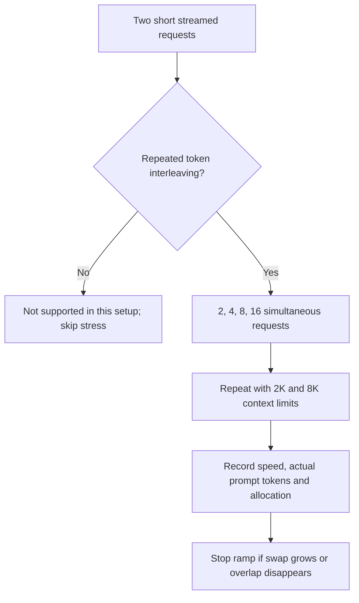

# Parallel capability and capacity

Choose **Parallel capability + stress** in Run benchmarks, or run `make bench-parallel MODEL=gpt-oss:20b`. This replaces long quality campaigns for this option. Existing quality benchmarks remain separate.

The runner starts an isolated Ollama endpoint with sixteen request slots. It never changes the owner's server configuration, downloads weights or runs alongside another lab GPU test. An owner-loaded model prevents startup. The temporary model and server are cleaned up on normal completion, error or cancellation.

Supported means repeated interleaved streamed output, not merely overlapping network requests. Not supported applies to the tested digest, engine and configuration, not every possible engine. Errors remain errors. Direct/no-thinking output is used to keep capability testing short; this says nothing about correctness or reasoning quality.

Stress uses 128-token outputs and distinct reference-text prompts. Actual prompt tokens are saved; 8K is a context limit, not a claim that every prompt fills 8K. Model allocation is reported by Ollama and is not measured physical peak RAM. The ramp stops after a level if swap grows by more than128 MiB, or fewer streams interleave than requested. This bounded smoke does not establish maximum safe capacity or prolonged workload stability.

Results are in Results → Parallel requests. Old queued concurrency jobs automatically use the gated runner when started. The queue remains paused until explicitly resumed.
